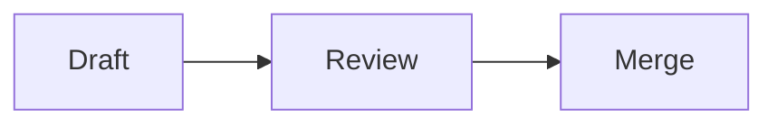

# kiri – kitty reader

kiri shows Markdown documents in the [kitty](https://sw.kovidgoyal.net/kitty/)
terminal the way a browser would: headings in a genuinely larger font,
images, formulas and diagrams drawn inline, and links you can click. It works
like `kitten icat`, but for documents. CSV and TSV files are shown as
tables, and other document formats may follow.

> **Status:** early development. Print mode, images, Mermaid diagrams
> and the interactive pager work; formulas and other diagram languages
> are still to come. See the [roadmap](docs/roadmap.md).

## Why

Existing terminal Markdown viewers limit themselves to plain ANSI text, so
every heading is the same size as body text and anything visual is left out.
kitty can do more: its text sizing protocol draws text at several sizes, and
its graphics protocol displays images that scroll with the text. kiri is built
around those features. Other terminals get ANSI colours instead, and output
that is not a terminal gets plain text.

## Usage

```sh
make release
target/release/kiri README.md
target/release/kiri photo.jpg
some-command | target/release/kiri
```

kiri asks the terminal what it supports and uses the best it gets: kitty's
large headings and clickable links, plain ANSI colours elsewhere, and plain
text when the output is a pipe.

kiri follows your terminal's colour scheme. `--light` and `--dark` draw
the document on a page of fixed colours instead, white or dark grey, like
a page in a browser: text and everything around it in greys, and colour
only in code blocks. They also choose code colours for a light or dark
background, which kiri otherwise takes from the terminal's background.

With [`NO_COLOR`](https://no-color.org) set to anything but an empty value,
kiri uses no colours in any mode. Bold, italic, underlines, links and heading
sizes stay; code blocks are not highlighted, and inline code is shown in
backticks.

Quotes that start with `[!NOTE]`, `[!TIP]`, `[!IMPORTANT]`, `[!WARNING]`
or `[!CAUTION]` are drawn as GitHub draws these alerts: a bar and a title
in the kind's colour, on a tint of it, and in kitty the kind's icon.

Emoji shortcodes such as `:rocket:` are shown as their emoji, as on GitHub.

A fenced code block with a language, such as `python`, names it in its
top-right corner. The [theme](docs/theme.md) can turn the name off.

Tables too wide for the window wrap the text inside their cells, without
splitting any word of ten cells or fewer. When that is not enough, each row
is shown as its own block of `Header: value` lines instead.

Every second row of a table is shaded a little, on light and dark
backgrounds alike. Where shading cannot show, such as in a pipe or with
`NO_COLOR`, nothing marks the rows: `--table-rows lines` draws a rule
between them, and `--table-rows indent` starts the next lines of a
wrapped value two cells in. `underline` and `off` are the other choices.

An image that is the only thing in its paragraph is drawn as a block, at
its size in CSS pixels as a browser would show it and no wider than the
text; images inside running text show their alt text for now. HTML ``
tags work too, with `width` and `height` in pixels or a percentage width,
also when a link, `<p>`, `<div>` or `<picture>` wraps them. Only such a
size enlarges an image.

A code block in Mermaid is drawn as a diagram, as GitHub draws it:

````markdown

````

kiri's default build draws Mermaid itself, every diagram type, through
[merman](https://crates.io/crates/merman); a build without default
features uses mermaid-cli's `mmdc` when it finds one, and shows the PNG
its browser draws. On a dark page a diagram takes Mermaid's dark theme,
unless it chooses a theme of its own. Diagrams are drawn where images
are, so they stay code with `--no-images`, in terminals without kitty's
graphics and with `--diagrams off`. A diagram that does not draw stays
code, and kiri tells why in red below it and in a warning, or in only
one of them with `--render-errors`. The
[configuration file](docs/diagrams.md#diagram-commands) can name another
program to draw them.

HTML `<details>` blocks are shown open, their `<summary>` in bold after a
`▼`, also nested and inside lists and quotes. `<kbd>` is drawn as inline
code, `<br>` breaks the line, and `<mark>` takes the theme's `mark`
colours, black on yellow by default. Other HTML is shown as muted source.

Front matter, the metadata block at the start of a file that Jekyll,
Hugo, Obsidian and agent skills write, is shown as a table of its keys
and values, as on GitHub: YAML between `---` lines, TOML between `+++`
and JSON between `;;;`. Nested maps become tables in their cells.
`--front-matter code` shows it as a code block, as GitLab does, `hide`
leaves it out and `off` reads it as Markdown.

An image file given on its own, `kiri photo.jpg`, is shown as large as
fits the window but never enlarged, even when images are off. Its
extension and first bytes tell kiri that it is an image, and `--format`
can say so instead. A terminal without kitty's graphics gets an error.

A Mermaid file, `kiri plan.mmd` or `.mermaid`, is drawn on its own in
the same way, by the same renderer and settings as a diagram in a
document, and also with images off; `--format mermaid` says so for
standard input or another name. Where it is not drawn, as with
`--diagrams off` or in a terminal without kitty's graphics, its source is
shown as `--format text` shows it, and a diagram that fails to draw is an
error, told below its source as in a document. When no program can draw
it, as in a build without the built-in renderer and without `mmdc`, a
hint on standard error points to `kiri --doctor`.

A CSV or TSV file is shown as a table with its first row as the header,
as GitHub shows one: `.csv` is comma-separated and `.tsv` tab-separated,
and `--format csv` or `--format tsv` says so for standard input. Cells are
plain text. A file of more than 100 000 cells shows the rows that fit and
a note of how many were left out.

`--format text` shows any file as it is, without rendering it: a
Markdown file's source, or a Mermaid file's, in a code block, highlighted
when its extension names a language kiri knows. It is paged as a document
is, and `-M` leaves out the code block's padding for copying. In plain
output, as into a pipe or a file, or with `--mode plain`, it writes the
file exactly as it is, as `cat` does.

Without a file name, or with `-`, kiri reads the document from standard
input, so another command's output can be piped into it; images in it are
relative to the current directory. A directory shows its `README.md`, or
else its `README`, as GitHub does.

Images come from `data:` URLs and local files: absolute paths, paths
relative to the document and `file:` URLs, with any `?query` or `#fragment`
left out as in a browser. kiri reads only regular files up to the
`--max-image-size` limit, which also caps a compressed SVG once
decompressed, and does not fetch remote images. kiri shows PNG, JPEG, GIF
(the first frame), WebP and SVG images, and in its default, full build
also BMP, ICO, TIFF, QOI, PNM and TGA. A build without default features
(`cargo build --no-default-features`) leaves those out and shows their
alt text with a warning.

Every option is listed in [Options](docs/options.md).

A [configuration file](docs/config.md), `~/.config/kiri/config.toml`, can
choose the theme, turn images or diagrams off, say when to page and name
a program that draws diagrams, and the
[environment variables](docs/config.md#environment-variables) can do all
but the last.

When the output looks wrong, `kiri --doctor` shows what kiri found out
about the terminal, which settings it uses and where each came from, and
what draws diagrams, with a sample of headings, a table and an image drawn
below. `kiri --doctor --raw` gives the report as Markdown without the
sample, to paste into a bug report; piped to a file, the report is
Markdown with the sample.

A document longer than the window opens in a pager on a screen of its
own, as `bat` does, so the shell's scrollback stays as it was; a shorter
one is printed, and so is a document piped in, unless `-p` asks for the
pager. The pager takes the keys of `less` for now: `j` and `k` or
the arrow keys for a line, space and `b` for a page, `d` and `u` for half a
page, `g` and `G` for the start and the end, and `q` to quit; `?` or `h`
lists them. The mouse wheel scrolls too. Large headings scroll in and out
whole. A status line at the bottom shows the document's name and how far
down it you are.

`/` searches the document for plain text, and `n` and `N` move to the next
and the previous match; Enter at an empty `/` prompt goes on to the next
match of the last search, as in `less`. Escape hides the highlight. A term
in lower case matches either case, and one with an upper-case letter
matches exactly, unless `search_case = "literal"` in the
[configuration file](docs/config.md#search-case) makes every search exact.
The search looks at the lines as they are laid out, so a phrase broken
over two lines is not found, and neither is the alt text of an image that
is shown. Link navigation is planned.

## Documentation

- [Roadmap](docs/roadmap.md)
- [Architecture](docs/architecture.md)
- [Configuration](docs/config.md)
- [Diagrams](docs/diagrams.md)
- [Options](docs/options.md)
- [Theme](docs/theme.md)
- [Visual check](examples/visual-check.md) – a document for checking the
  output by eye, and [another for images](examples/visual-check-images.md)
- [Mermaid showcase](examples/mermaid-showcase.md) – one diagram of each
  common Mermaid type, also as [files of their own](examples/mermaid/)
- [AGENTS.md](AGENTS.md) – conventions for coding agents and contributors

## License

Not decided yet.
