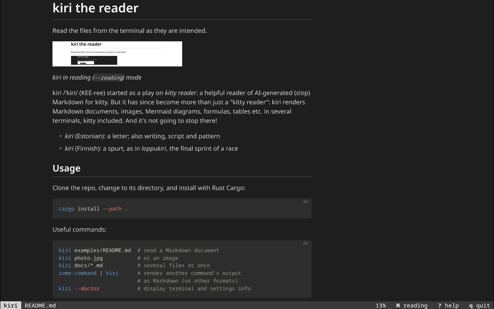

# kiri the reader

Read the files from the terminal as they are intended.

<picture>
  <source media="(prefers-color-scheme: dark)" srcset="docs/assets/kiri-reading-light-window.png">
  
</picture>

_kiri in reading mode, the default where the terminal draws images_

kiri /ˈkiri/ (KEE-ree) started as a play on _kitty reader_:
a helpful reader of AI-generated (slop) Markdown for kitty.
But it has since become more than just a "kitty reader": kiri renders
Markdown documents, images, Mermaid diagrams, formulas, tables etc. in
several terminals, kitty included. And it's not going to stop there!

* _kiri_ (Estonian): a letter; also writing, script and pattern
* _kiri_ (Finnish): a spurt, as in _loppukiri_, the final sprint of a race


## Usage

Clone the repo, change to its directory, and install with Rust Cargo:
```sh
cargo install --path .
```

Useful commands:
```sh
kiri examples/README.md  # read a Markdown document
kiri photo.jpg           # or an image
kiri docs/*.md           # several files at once
some-command | kiri      # render another command's output
                         # as Markdown (or other formats)
kiri --doctor            # display terminal and settings info
```

And a few others for paging (especially for Markdown):
```sh
kiri README.md -f        # automatically reload the page on file changes
kiri README.md --fa      # and also jump to the edited part (F to cycle)
kiri README.md --no-reading # the text layout, for copying (M to toggle)
```

Use `--light` / `--dark` to view the document in light / dark mode.

For the shell completions, add following line to your `~/.bashrc`:
```sh
eval "$(kiri --completions bash)"
```
for other shells, see [options](docs/options.md).

Documentation:
* [configuration](docs/config.md)
* [themes](docs/theme.md)
* [doctor](docs/doctor.md): diagnostics


## Support

> [!IMPORTANT]
> kiri is still in early development.


### Terminals

| Terminal  | Large headings  | Images  | Mouse wheel  |
|---|---|---|---|
| kitty  | :white_check_mark: | :white_check_mark:  | :white_check_mark: |
| Ghostty  | via images  | :white_check_mark:  | :white_check_mark:  |
| tmux (in kitty & Ghostty) | via images  | :white_check_mark:  | :white_check_mark:  |


### Features

:white_check_mark: works · :yellow_circle: partly · :clipboard: planned


#### File formats

| Format | Extensions | Status | Notes |
|---|---|---|---|
| Markdown | .md, .markdown | :white_check_mark: | |
| Images | .png, .jpg, .webp, .svg, .svgz | :white_check_mark: | |
| Animated images | .gif, animated .webp and .png | :white_check_mark: | started by hand; first frame only in tmux |
| More images | .bmp, .ico, .tiff, .qoi, .pnm, .tga | :white_check_mark: | default build only |
| CSV, TSV | .csv, .tsv | :white_check_mark: | first row is the header |
| Mermaid | .mmd, .mermaid | :white_check_mark: | |
| Any other text file | .yaml, .json, .rs, .txt and others | :white_check_mark: | shown as it is, with syntax highlighting when kiri knows the language; `--format text` shows a Markdown file as its source |
| Notebooks | .ipynb | :clipboard: | |
| PDF | .pdf | :clipboard: | pages as images |
| Video | .mp4, .webm and others | :clipboard: | through ffmpeg |


#### Markdown

| Feature | Status | Notes |
|---|---|---|
| ***CommonMark*** | | |
| Headings | :white_check_mark: | sized text in kitty, images elsewhere |
| Emphasis, lists, quotes | :white_check_mark: | |
| Links | :white_check_mark: | clickable |
| Code blocks | :white_check_mark: | highlighted, language named in the corner |
| Images | :yellow_circle: | images inside running text show alt text<sup>*</sup> |
| ***GitHub extensions*** | | |
| Tables | :white_check_mark: | wrap to fit the window |
| Task lists, strikethrough, autolinks | :white_check_mark: | |
| Footnotes | :clipboard: | |
| ***GitHub extras*** | | |
| Alerts, emoji shortcodes | :white_check_mark: | |
| Mermaid | :white_check_mark: | every diagram type |
| Formulas | :yellow_circle: | inline `$x$` shown as written<sup>*</sup> |
| Front matter | :white_check_mark: | shown as a table or code block |
| Links within the document | :clipboard: | |
| ***HTML*** | | |
| `<details>`, `` | :white_check_mark: | details shown open |
| `<kbd>`, `<br>`, `<mark>`, `<sub>`, `<sup>` | :white_check_mark: | |
| `align="center"` | :clipboard: | |
| Other HTML | :yellow_circle: | shown as muted source |

<sup>*</sup>_drawn in reading mode_


#### Other

| Feature | Status | Notes |
|---|---|---|
| ***Rendering*** | | |
| Reading mode | :white_check_mark: | browser-like rendering, on by default where images are drawn; `--no-reading` and `M` |
| ***Pager*** | | |
| Paging | :white_check_mark: | long documents open in a pager; `-p` always, `-P` never |
| Search | :white_check_mark: | `/`, `n` and `N`, as in `less` |
| Several files | :white_check_mark: | `:n` and `:p` move between them |
| Reload | :white_check_mark: | `r` |
| Follow a file | :white_check_mark: | `-f`; `--fa` also moves to the changed part |
| Table of contents | :clipboard: | |
| Choosing links with the keyboard | :yellow_circle: | <kbd>Tab</kbd> selects a link, <kbd>Enter</kbd> copies its address |
| Copying code blocks | :clipboard: | |
| ***Look*** | | |
| Themes | :white_check_mark: | your own theme file with `--theme`; `--light` and `--dark` pages |
| Built-in themes by name | :clipboard: | |
| `NO_COLOR` | :white_check_mark: | |
| Plain text into a pipe | :white_check_mark: | |
| ***Settings and help*** | | |
| Configuration file | :white_check_mark: | `~/.config/kiri/config.toml` and environment variables |
| `--doctor` | :white_check_mark: | what kiri found out about the terminal, and which settings it uses |
| Settings menu in the pager | :clipboard: | |
| Shell completions | :white_check_mark: | `--completions SHELL` |
| Man page | :clipboard: | |


## Development

kiri has been developed mostly by AI tools (Claude).

Useful commands:
```sh
make check          # run formatting, lints and tests
make build-release  # build the optimised binary
```

See also:
* [architecture](docs/architecture.md)
* [roadmap](docs/roadmap.md)
* [AGENTS.md](AGENTS.md): instructions for agents (duh)


## Acknowledgements

kiri is built upon these awesome tools and packages:
* [comrak](https://crates.io/crates/comrak): Markdown parsing
* [syntect](https://crates.io/crates/syntect) and [two-face](https://crates.io/crates/two-face): syntax highlighting, with the grammars of two-face
* [resvg](https://crates.io/crates/resvg): SVG images, also for rendering diagrams and formulas
* [image](https://crates.io/crates/image): reading raster images
* [fast_image_resize](https://crates.io/crates/fast_image_resize): image scaling
* [parley](https://crates.io/crates/parley) and [skrifa](https://crates.io/crates/skrifa): reading mode typesetting
* [merman](https://crates.io/crates/merman): [Mermaid](https://mermaid.js.org/) diagrams
* [RaTeX](https://crates.io/crates/ratex-parser) and [KaTeX](https://katex.org/): LaTeX formulas
* [Octicons](https://github.com/primer/octicons): icons for Markdown alerts
* [jailbee](https://jailbee.gisgro.io): AI tooling and environment isolation
* last but not least, [kitty](https://sw.kovidgoyal.net/kitty/): terminal protocols that kickstarted kiri


## Why

> With the advent of AI coding tools, such as opencode, Claude Code,
> Codex and Pi, the terminal has not faded away. Instead, I have noticed
> that the IDE stays closed most of the time and the terminal, with its
> tabs and panes, is all too familiar in my everyday work.
>
> kiri is one step towards making the terminal environment a bit more
> manageable. I shouldn't need to open a plethora of GUI tools and
> a browser just to look at a document, an image or a PDF before
> answering "do I prefer option A or B?".
>
> kiri should be enough.

\- toravasaari


### Inspiration

Sources of inspiration:
* [bat](https://github.com/sharkdp/bat): paging, and syntax highlighting for every code file
* [less](https://www.greenwoodsoftware.com/less/): key bindings
* [btop](https://github.com/aristocratos/btop): styling, menu and themes
* `kitten icat`: images
* GitHub's and Forgejo's visual style for the README pages

There are other awesome Markdown readers that you should definitely check out:
* [kitty-markdown-viewer](https://github.com/calii23/kitty-markdown-viewer) - a full-screen
  viewer for kitty with a table of contents, copy tools and much more
* [glow](https://github.com/charmbracelet/glow) - "Render markdown on the CLI, with pizzazz!"
* [mdfried](https://github.com/benjajaja/mdfried) - "renders headers as Bigger Text"
* [mdcat](https://github.com/swsnr/mdcat) (archived) - still gets its job done


## Licence

kiri is licensed under the MIT License; see [LICENSE](LICENSE).

Licences and copyright notices of the third-party software and
assets are included in each release archive, in `THIRD-PARTY-NOTICES.md`.
