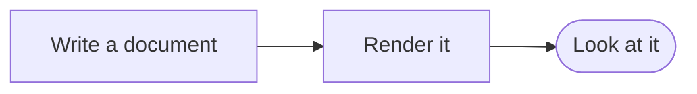

# Examples

A document for checking kiri's output by eye in a real kitty window. It has
one typical example of each main feature, so a quick look at it is fairly
complete on its own. Each section says what you should see there with the
default theme; anything else is a bug. The edge cases are in the topic
documents, which this one links to at the end. A theme of your own, from
`~/.config/kiri/theme.toml`, `KIRI_THEME` or the
[configuration file](../docs/config.md), changes what you see. Other
terminals show less, and without colours (`NO_COLOR` or plain text) inline
code is shown in backticks.

The commands below use `kiri`; from a checkout, `cargo run --` in its place
does the same. View this document with the default theme, then with the
example themes that draw heading bands and rules, with a solid page behind
the images, on the light and dark paper themes, and without colours:

```sh
kiri examples
kiri --theme examples/themes/background.toml examples
kiri --theme examples/themes/rules.toml examples
kiri --theme examples/themes/opaque.toml examples
kiri --light examples
kiri --dark examples
NO_COLOR=1 kiri examples
```

On paper, the document lies on a white or dark grey page as wide as the
window, and everything but the code blocks, the alerts and the images is
in greys: no blue headings or links, no magenta inline code.

The other documents in this directory are named `S`, for showcase, and a
number for their topic. Each shows several files, one after another under a
header with the file's name:

```sh
kiri examples/S*.md
kiri examples/S*
kiri examples/S07*
kiri examples/*
```

The first shows all the topic documents. The second also shows the CSV,
image and Mermaid files, and the third one topic, here the diagrams. The
last also takes `themes/`, which it shows through its README, and
`mermaid/`, a directory without a README. kiri reports that one as an error
at its place among the files, and shows the rest. That error is intended: it
checks a file that cannot be shown.

Try a wide window and a narrow one (about 40 columns), where the commands
above wrap like any long code line. No line reaches past the right edge of
the window.

## Headings

Level one is three times the normal size, levels two and three twice, and
levels four to six normal size. Underlines, weight, colour and italic tell
the levels of the same size apart.

### Level three

#### Level four

## Text

A paragraph with *emphasis*, **strong text**, ~~strikethrough~~, inline
code such as `make check`, and [a link](https://example.com) that is
underlined and opens its page. Wide characters take two cells each and never
split: 日本語のテキスト, 🦀 and 🇫🇮.

---

The line above is a thematic break, a rule across the whole window.

## Lists

- A list item
  - A nested item
- [x] A finished task, with a checked box
- [ ] An open task, with an empty box

1. A numbered item
2. Another one

## Block quotes

> A quote has a bar down its left edge, and its text starts after the bar.

## Code

A short highlighted block, on a background of its own that ends at the
same right edge on every line:

```rust
fn main() {
    println!("Hello, kiri");
}
```

## Tables

The borders are in line, the last column is aligned right, and the rows
have alternating shades.

| Name | Kind | Count |
|:-----|:----:|------:|
| Fern | plant | 12 |
| Crab | animal | 7 |

## Alerts

> [!TIP]
> A tip: green, with an icon and the bold title "Tip", over a faint tint
> of green as wide as the text.

## Images

A PNG: red, green, blue and yellow quadrants on a black grid, about 32
columns wide and 12 rows high. Elsewhere, and when an image cannot be
loaded, its alt text appears in brackets.


## Diagrams

A Mermaid diagram in a code block is drawn as an image in kitty, as GitHub
draws it, and stays code elsewhere and with `--no-images`. This flowchart
runs from left to right: three boxes joined by arrows, the last one
rounded. The labels sit inside the boxes and no text is cut off.



## Topics

- [Text](S01-text.md): headings, emphasis, links, wide characters, empty
  blocks
- [Lists and quotes](S02-lists-and-quotes.md): blocks inside list items and
  quotes, nested quotes
- [Tables](S03a-tables.md): narrow, stacked and wide tables
- [Code](S04-code.md): wrapping and inline code
- [Alerts](S05-alerts.md): the alert types
- [Images](S06a-images.md): every format and many special cases
- [Diagrams](S07a-diagrams.md): Mermaid diagrams
