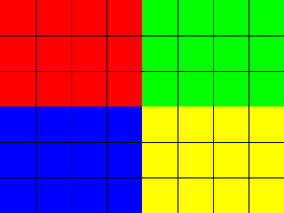
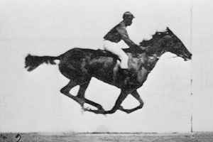
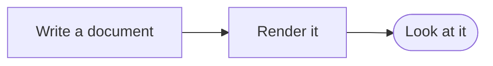

# Examples

A document for checking kiri's output by eye in a real kitty window, with
one typical example of each main feature. Each section says what to look
for; anything else is a bug. The edge cases are in the topic documents at
the end. A theme of your own, from `~/.config/kiri/theme.toml`,
`KIRI_THEME` or the [configuration file](../docs/config.md), changes what
you see, and other terminals show less. In xterm, start it with
`xterm -ti vt340` to turn on sixel; an animation then shows its first
frame only.

Plain `kiri` shows reading mode in a terminal that draws images. The
commands here give `--no-reading`, the text layout this document describes;
[Reading mode](S09-reading-mode.md) shows the other, and the topic
documents use plain `kiri`. From a checkout, `cargo run --` does the same as
`kiri`. View it with the default theme, the example themes, the paper
themes and without colours:

```sh
kiri --no-reading examples
kiri --no-reading --theme examples/themes/background.toml examples
kiri --no-reading --theme examples/themes/rules.toml examples
kiri --no-reading --theme examples/themes/opaque.toml examples
kiri --no-reading --light examples
kiri --no-reading --dark examples
kiri --no-reading --theme dark examples
NO_COLOR=1 kiri --no-reading examples
```

`--theme dark` is the same as `--dark`. Another name is `NAME.toml` in
`~/.config/kiri/themes/`, so `--theme mine` reads `mine.toml` there.

To page through it with each example theme in turn, where `q` moves on to
the next theme:

```sh
for theme in examples/themes/*.toml; do kiri -p --no-reading --theme "$theme" examples; done
```

In the pager each notch of the mouse wheel scrolls three lines, also in
tmux, and a click on a link follows it. In kitty, hold Shift to select text
with the mouse; with `kiri -p --no-reading --no-mouse examples` a drag
selects without Shift and the wheel is left to the terminal.

On paper the document lies on a white or dark grey page, and everything but
code blocks, alerts and images is in greys.

The other documents are named `S`, for showcase, and a number for their
topic. Given several files, kiri shows them one after another, each under a
header with its name. The header's band spans the whole window, also when the
text is narrower, and it is the same grey as the status line at the bottom.
Scroll down in a document in the pager and its file's name stays on the top
row, over the text, until the next file's header comes up, one row before it
reaches the top, so that the blank line between the files shows as it is. A
large heading that scrolls under the name is drawn smaller in the row below
it, and a heading you jump to is shown on the row below the name:

```sh
kiri --no-reading examples/S*.md     # the topic documents
kiri --no-reading examples/S*        # also the CSV, image and Mermaid files
kiri --no-reading examples/S07*      # one topic, here the diagrams
kiri --no-reading examples/*         # also themes/ and mermaid/
```

`mermaid/` has no README, so kiri reports an error at its place and shows
the rest; that is intended. The topic documents start with front matter,
drawn as a table; this one has none.

Try a wide window and a narrow one (about 40 columns); no line reaches past
the right edge. The width and margins can come from a flag, an environment
variable or the configuration file. These three show the same document,
wrapped at 40 cells with no left margin:

```sh
kiri --no-reading --width 40 --no-margins examples
KIRI_WIDTH=40 KIRI_MARGINS=off kiri --no-reading examples
printf 'width = 40\nmargins = false\n' > /tmp/kiri-narrow.toml
KIRI_CONFIG=/tmp/kiri-narrow.toml kiri --no-reading examples
```

## Headings

Each level is smaller than the one before; size alone tells them apart.

### Level three

#### Level four

## Text

A paragraph with *emphasis*, **strong text**, ~~strikethrough~~, inline
code such as `make check`, and [a link](https://example.com) that is
underlined. Wide characters take two cells and never split: 日本語のテキスト,
🦀 and 🇫🇮.

---

Above, a thematic break across the window.

## Lists

- A list item
  - A nested item
- [x] A finished task, with a checked box
- [ ] An open task, with an empty box

1. A numbered item
2. Another one

## Block quotes

> A quote has a bar down its left edge.

## Code

A short highlighted block, its background ending at the same right edge on
every line:

```rust
fn main() {
    println!("Hello, kiri");
}
```

## Tables

The borders are in line, the last column is aligned right, and the rows
alternate in shade.

| Name | Kind | Count |
|:-----|:----:|------:|
| Fern | plant | 12 |
| Crab | animal | 7 |

## Alerts

> [!TIP]
> A tip: green, with an icon and a bold title, over a faint tint.

## Images

A PNG: red, green, blue and yellow quadrants on a black grid, about 32
columns wide and 12 rows high. Without images, or when one cannot be loaded,
its alt text appears in brackets.



An animated GIF, Muybridge's race horse.



A small image in a sentence, such as the icon
 here, is drawn in its line.

## Diagrams

A Mermaid diagram in a code block is drawn as an image in kitty and in
terminals with sixel, as GitHub draws it, and stays code elsewhere and with
`--no-images`. This flowchart runs left to right: three boxes joined by
arrows, the last one rounded, with no text cut off.



## Formulas

A formula in a ` ```math ` block is drawn as an image in kitty and in
terminals with sixel, as GitHub draws it, and stays code elsewhere and with
`--no-images`. This fraction stands in the middle of the text's width, in
the text's colour: n(n + 1) above a line, 2 below it.

```math
\frac{n(n+1)}{2}
```

A formula in a line, such as $E = mc^2$ here, is drawn at about the size of
the text and keeps the line one row high. Elsewhere it stays as written.

## Topics

- [Text](S01-text.md): headings, emphasis, links, emoji, HTML tags
- [Lists and quotes](S02-lists-and-quotes.md)
- [Tables](S03a-tables.md), and a [CSV file](S03b-table.csv)
- [Code](S04a-code.md), a [YAML file](S04b-config.yaml) and a
  [text file](S04c-notes.txt) shown as text
- [Alerts](S05-alerts.md)
- [Images](S06a-images.md) in every format, and a
  [PNG file](S06b-pattern.png) on its own
- [Diagrams](S07a-diagrams.md), and a [Mermaid file](S07b-flowchart.mmd)
- [Formulas](S08-formulas.md)
- [Reading mode](S09-reading-mode.md): the text in a proportional font, as a
  browser shows it; experimental
- [Contents](S10-contents.md): the bar of headings beside the document, in a
  window of 110 columns or more
