# Images

Each section says what to look for; anything else is a bug.
[`README.md`](README.md) shows one PNG.

Images show in kitty unless turned off with `-I`, `KIRI_NO_IMAGES` or the
[configuration file](../docs/config.md). Elsewhere, and when an image cannot
be loaded, its alt text appears in brackets. An image is as large as in a
browser, enlarged only when HTML asks for a size, and never wider than the
text. kiri warns on stderr about the five images in "Alt text" that cannot
be loaded. This photo of a fern, 4845 pixels wide, is shrunk to the text
width:

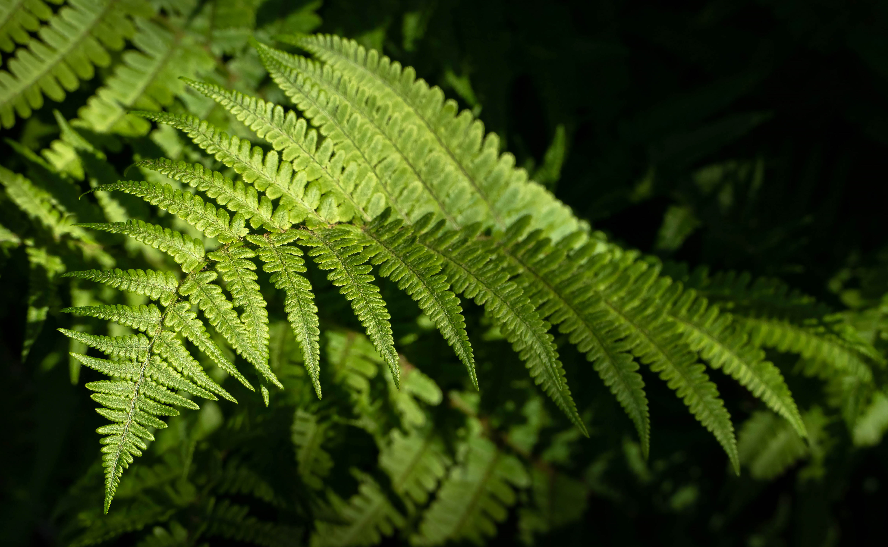

```sh
kiri examples/S06a-images.md
kiri --theme examples/themes/opaque.toml examples/S06a-images.md
kiri --light examples/S06a-images.md
kiri --dark examples/S06a-images.md
NO_COLOR=1 kiri examples/S06a-images.md
```

Transparent parts show the page behind them: the terminal's background, the
theme's `background`, or the page of `--light` and `--dark`. Try a wide
window and a narrow one (about 40 columns), where wide images shrink to the
text and small ones keep their size.

The first image of [`README.md`](README.md) is also a file of its own,
[S06b-pattern.png](S06b-pattern.png). Shown alone it is fitted to the
window, and with other files it comes under a header with its name:

```sh
kiri examples/S06b-pattern.png
kiri examples/S06*
```

Ghostty draws images as kitty does, also inside tmux, but each heading is
an image there. Inside tmux in kitty, with `set -g focus-events on` in
tmux.conf, try:

- `kiri -P examples/S06a-images.md`: every image draws, also the five under
  "Alt text"; kiri asks kitty after printing and sends again what did not
  come.
- `kiri -f examples/S06a-images.md`: change the top heading's text in
  another tmux window and come back, and the heading shows the new text.
  Undo the change afterwards.
- Switch to another tmux window or pane while an animation plays, or lose
  the kitty window's focus, and come back: the animation stands stopped on
  its first frame, with its play button.
- Ctrl+L redraws the screen and the images stay; quitting one of two panes
  with the pager leaves the images in the other.

## Animations

To play an animated GIF, WebP or APNG in the pager, click it, or select it
with Tab and press `p` or Enter. It shows its first frame with a play
button. A white half circle turns on it while its frames get ready, and
then it plays. A second click or `p` stops it, back on its first frame, and
starting another animation stops the one that plays. It plays as often as
its file says, at most 3 times (`animation_plays` in the configuration
file; 0 is without limit), and then rests on its last frame with a replay
icon. Scrolling stops it. The status line tells what plays, in a pill at
its right: the alt text, a bar and the time, as `3.2 / 8.0 s`; the key
hints come back when Esc takes the pill off. Tab scrolls to show the whole
picture. Printed, with `-P`, an animation shows its first frame.

Muybridge's race horse, 15 frames of a tenth of a second, gallops for a
second and a half and stands in its last pose. In reading mode the picture
that plays is drawn over the page. Ghostty inside tmux shows the first
frame.

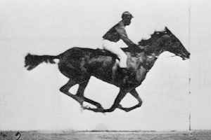

Four more, close together: a square that turns from red to green to blue,
from a GIF and from a WebP, a puzzle piece with eyes, and a bouncing beach
ball from an APNG. Click one and it plays while the others stay still;
click another and the first goes back to its first frame. Two never play at
once.

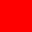


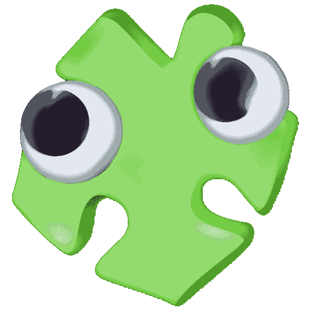

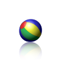

An animation in a table that scrolls sideways, or in a line of text, shows
its first frame in reading mode. Try `kiri --wide scroll
examples/S06a-images.md`: the puzzle piece sits in a cell of a table too
wide for the window, which scrolls with ← and →. Its header is one unbroken
word per cell, so the cells cannot wrap.

| ThIsHeAdErIsSoLoNgBeCaUsEiTiSaPaRtOfThEpArAgRaPhBeFoReItWrItTeNwItHoUtSpAcEsSoThAtThEtAbLeCaNnOtWrApAnDhAsToScRoLlSiDeWaYs | ScRoLlThEtAbLeSiDeWaYsWiThThEaRrOwKeYsToSeEtHeCeLlWiThThEpUzZlEpIeCeAnDtHeWoRdBeSiDeIt |
|---|---|
|  | and a word beside it |

## Scaling

The test pattern, red, green, blue and yellow quadrants on a black grid,
about 32 columns wide and 12 rows high:

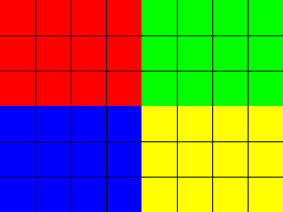

A checkered icon of about two cells, not enlarged:


A gradient from yellow to blue as wide as the text, and a tall one about 20
columns wide:


A lake in portrait format at 30% of the text width:

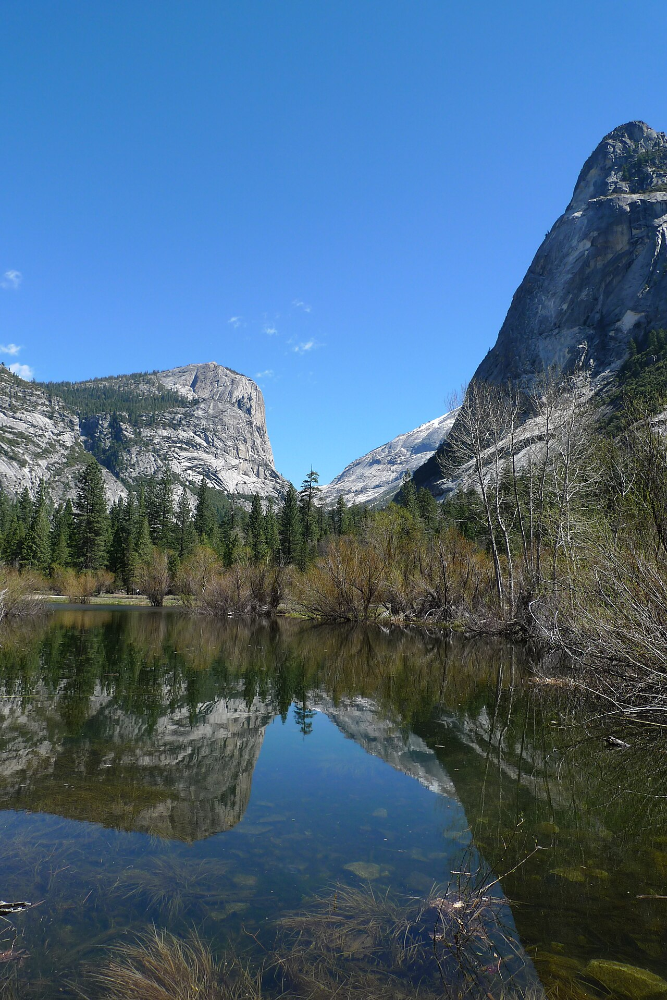

## Formats

Each group is a few small images side by side, so that a whole format
fits on the screen.

The same lake under clouds eight times, each upright although the files
store it turned and mirrored in every way EXIF allows, and then the test
pattern stored on its side in a PNG and a WebP, red at the top left:

Orientation:\

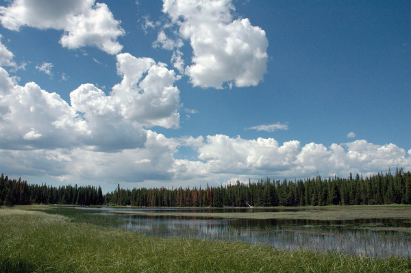
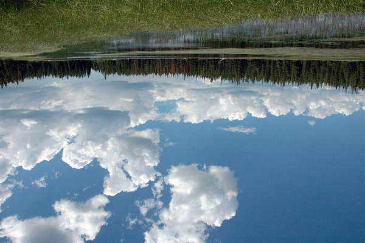
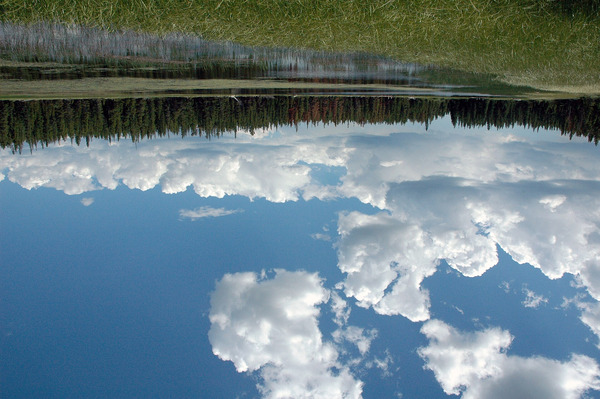
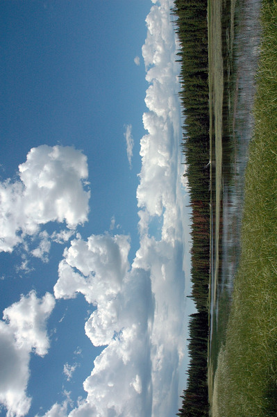
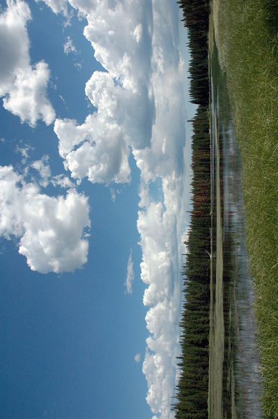
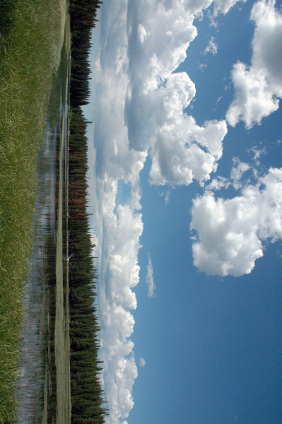
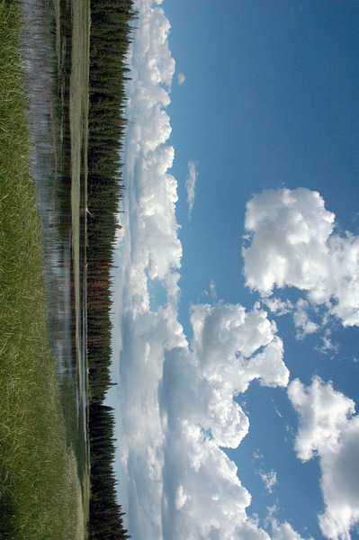
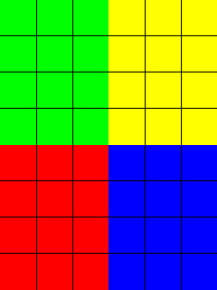


The lake as a baseline, a progressive and a CMYK JPEG, with the same
colours, then a file cut off halfway, whose lower part is grey or smeared:

JPEG:\

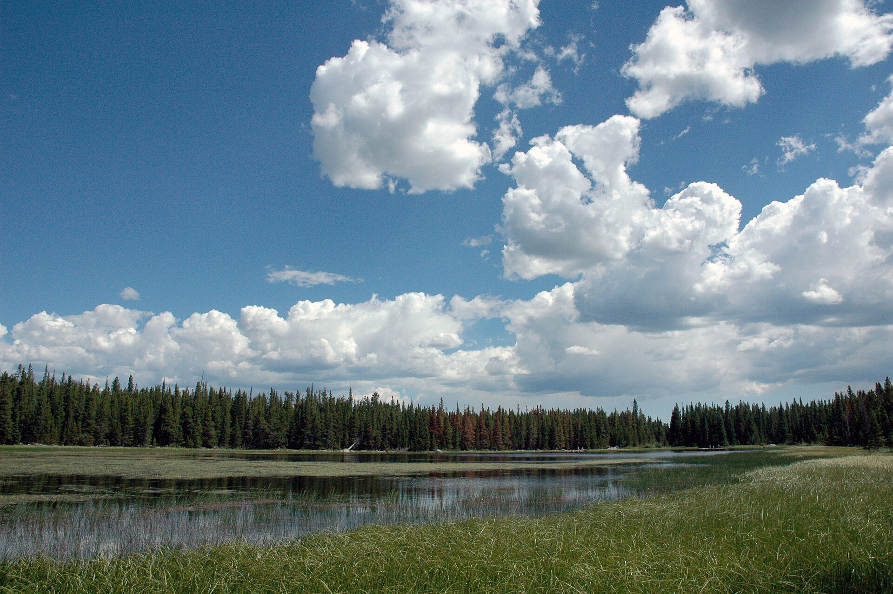


PngSuite images: 16-bit grey, an 8-bit palette, 16-bit colour with alpha,
interlaced grey and a palette with a transparent background, then a lossy
WebP and a lossless one of grey noise:

PNG and WebP:\

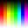
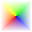
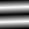
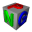

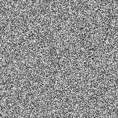

SVGs are sharp at any size: the test pattern without its grid, from a
plain file and from a gzip-compressed one, a sunset in gradients and a
soccer ball:

SVG:\
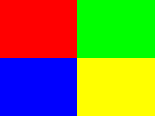


Four SVGs are black lines on a transparent background, as in a browser, so
they show only on a light background, a light terminal or `--light`: the
forces on an airfoil, labelled in Greek in the system's sans-serif font, a
gearset diagram labelled in its serif font, a racetrack with numbered
corners, and a silhouette with softly blurred edges:

Black SVG:\
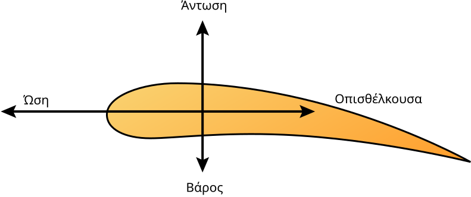
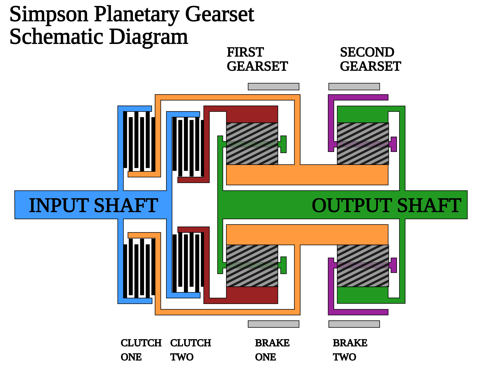
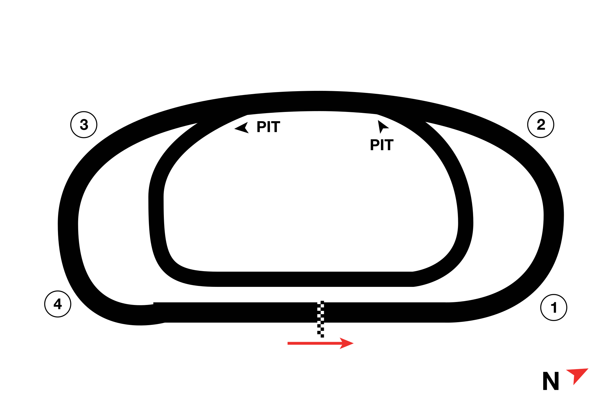
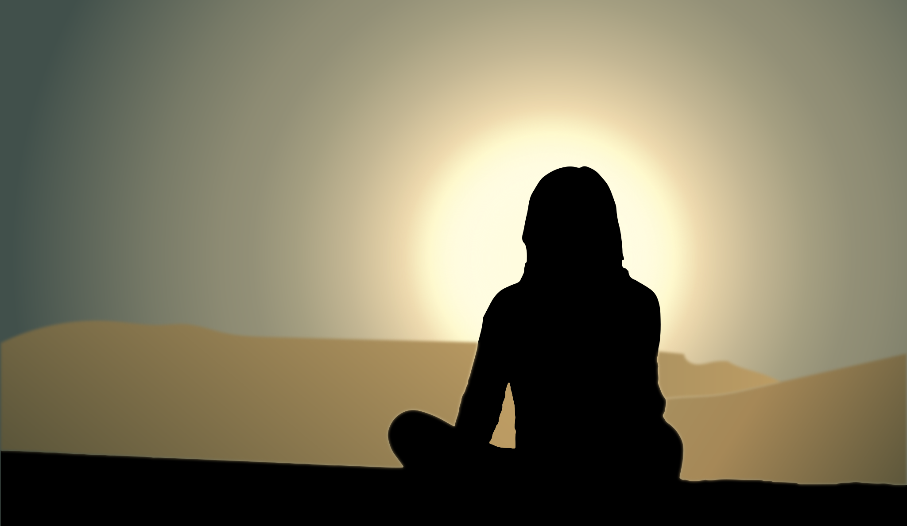

The full build, the default, also shows BMP, TIFF, QOI, PPM, TGA and ICO.
Here is the test pattern in the first five, each like the first image on
this page, and the transparency example in an ICO. A build without default
features shows their alt text and warns about each:

Formats:\


## Transparency

A red disc and a half-transparent blue square, with the background showing
around them and through the square:

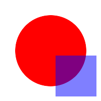

A compass rose without a background of its own, shrunk to the text width.
Its thin lines and points have clean edges, with no halo on any
background:

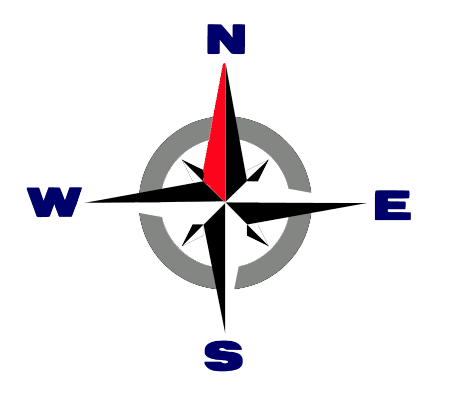

## Lists, quotes and links

Images in a list and a quote start after the bullet and the bar, and the
bar runs beside every row of the image:

- 

- An item with text, then an image lined up with the text:

  

> 

> > 

A linked image shows, but clicking it does nothing yet:

[](https://example.com)

## HTML images

An `` on a line of its own shows like a Markdown image: the checkered
icon of about two cells.


A logo wrapped and centred the way READMEs do it shows in the middle of the
line: the test pattern at half its size, about 16 columns by 6 rows.

<p align="center">
  
</p>

The test pattern squashed to 16 columns and 2 rows:


The icon enlarged to about 7 columns and 4 rows, a little soft:


The panorama at half the text width:


A `<picture>` shows its ``, the red disc and blue square, never its
`<source>`, a tall gradient:

<picture>
  <source media="(prefers-color-scheme: dark)" srcset="../tests/fixtures/images/portrait.png">
  
</picture>

A linked icon shows, but clicking it does nothing yet:

<a href="https://example.com"></a>

## In running text

An image in the middle of a line is drawn in the line's cells. A small one
keeps its size: the icon in  this
sentence is two cells wide, and the line is one row high. So is the icon in
a link, [ with
words](https://example.com), and each of two images side by side:
 

A badge, an image at most one row high and more than twice as wide, keeps its
shape:  is
the panorama as a strip standing in the line.

An image a little too high for the row is shrunk into it, keeping its shape:
 is the compass rose, a
little smaller than the row.

A tall image makes its line higher, with its bottom on the text's baseline.
Here  the test pattern is five rows high, and
these words are on the last.

## Alt text

An image in a table cell still shows its alt text in brackets, for now. An
image in a heading is drawn in the heading's rows, at its own size with its
bottom on the heading's row, as the icon here is:

### A heading with 

| Image | Note |
|---|---|
|  | Alt text in a table |

A missing file, a file that is no image, a broken SVG, an image with too
many pixels and a remote image show their alt text, and kiri warns about
each on stderr:


## In reading mode

In reading mode, which is the default, an image is in the page at its
natural size in CSS pixels, shrunk to the column when it is wider. An image
in the middle of a line stands on its baseline, as the badge here does:
. An image that cannot
be shown is its alt text in grey.
