# Images

A document for checking kiri's images by eye in a real kitty window, beside
[`README.md`](README.md), which shows one PNG. Each section says what you
should see; anything else is a bug.

Images show in kitty unless turned off with `-I`, `KIRI_NO_IMAGES` or the
[configuration file](../docs/config.md). Elsewhere, and when an image cannot
be loaded, its alt text appears in brackets. An image is as large next to
the text as in a browser, enlarged only when HTML asks for a size, and
never wider than the text.
kiri warns on stderr about the images it cannot load: here the five in the
last section.

View it with the default theme, on a document background, on the light
and dark paper themes, and without colours:

```sh
kiri examples/S06a-images.md
kiri --theme examples/themes/opaque.toml examples/S06a-images.md
kiri --light examples/S06a-images.md
kiri --dark examples/S06a-images.md
NO_COLOR=1 kiri examples/S06a-images.md
```

Transparent parts of images show the page behind them: the terminal's
background, the theme's `background`, or the white or dark grey page of
`--light` and `--dark`.

Try a wide window and a narrow one (about 40 columns), where the wide images
shrink to the narrower text and the small ones keep their size.

The first image of [`README.md`](README.md) is also a file of its own,
[S06b-pattern.png](S06b-pattern.png). Shown alone it is fitted to the
window, and under a header with its name when shown with other files:

```sh
kiri examples/S06b-pattern.png
kiri examples/S06*
```

## In Ghostty

Ghostty draws the images as kitty does, also inside tmux. It cannot draw
text at larger sizes, so each heading is an image there, in a colour from
Ghostty's palette, and the images in this document look as they do in
kitty.

## Inside tmux

Inside tmux in kitty, the images show as they do outside it. Try these
there, with `set -g focus-events on` in tmux.conf:

- `kiri -P examples/S06a-images.md` prints the document, and every image
  draws, also the five under "PNG variants" below, which tmux can lose
  on a slow connection: kiri asks kitty for them after printing and sends
  again what did not come.
- `kiri -f examples/S06a-images.md` follows the file in the pager, where
  inside tmux each heading is an image. Switch to another tmux window,
  change the text of the heading at the top of the view there, and come
  back: the heading shows its new text, where without `focus-events` its
  row stays empty until Ctrl+L. Undo the change afterwards.
- Ctrl+L in the pager draws the screen again: nothing on it changes, and
  the images stay.
- The pager on this document in two panes side by side: quitting one
  leaves the images in the other.

## Scaling

Red, green, blue and yellow quadrants on a black grid, about 32 columns
wide and 12 rows high:


A checkered icon of about two cells, not enlarged:


A gradient from yellow on the left to blue on the right, as wide as the
text:


A tall gradient from yellow to blue, about 20 columns wide:


A lake in portrait format, and a large photo of a fern, 4845 pixels wide,
both shrunk to the text width:

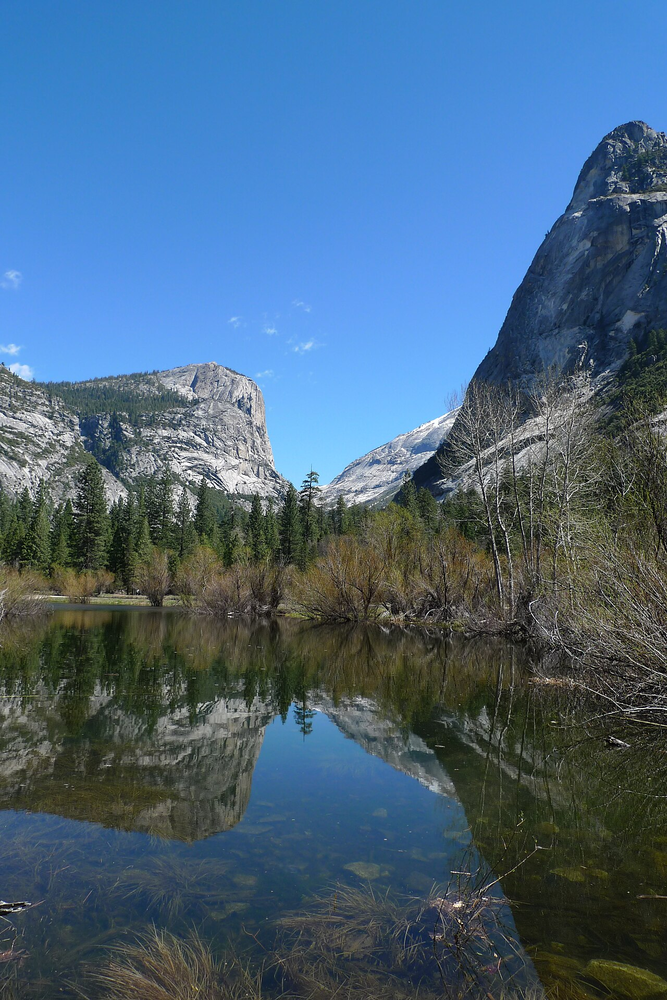

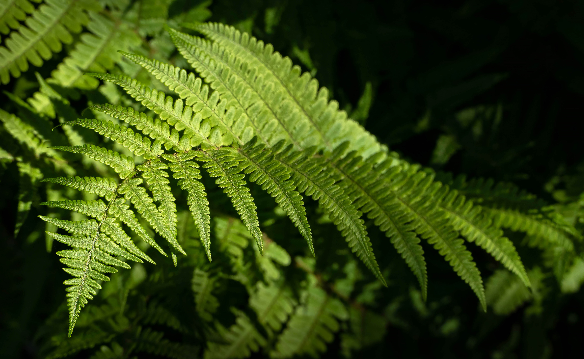

## EXIF orientation

The same photo of a lake under clouds eight times, about 60 columns wide,
each upright although the files store it turned and mirrored in every way
EXIF allows:


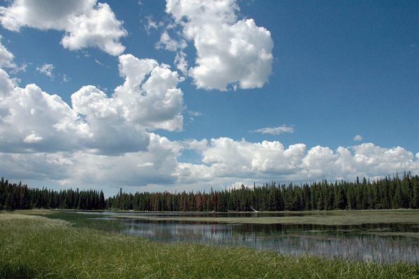

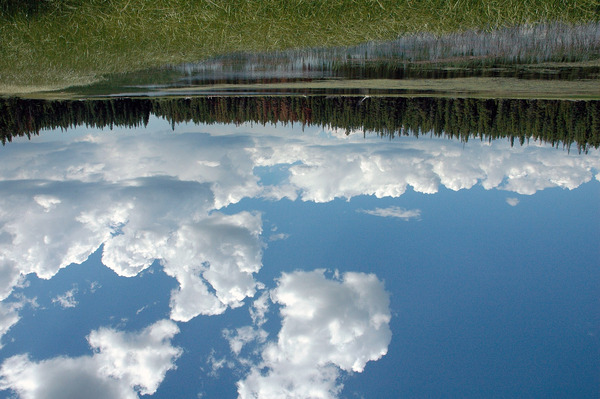

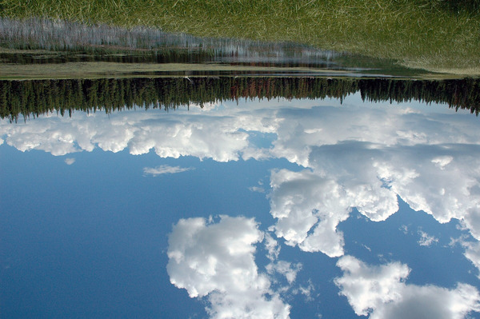

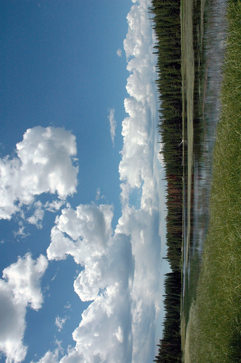

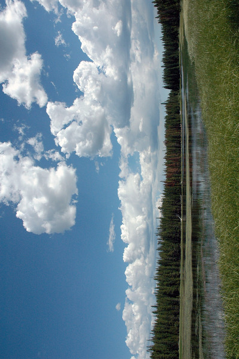

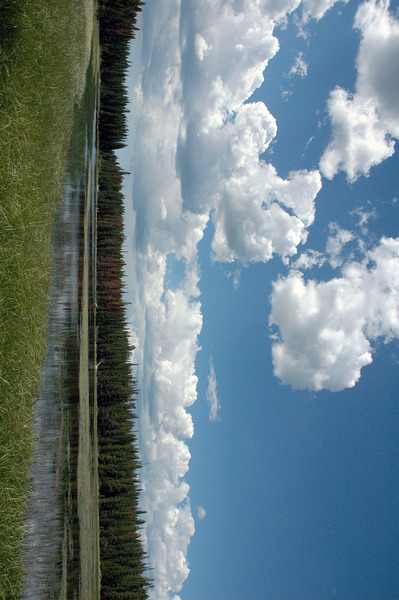

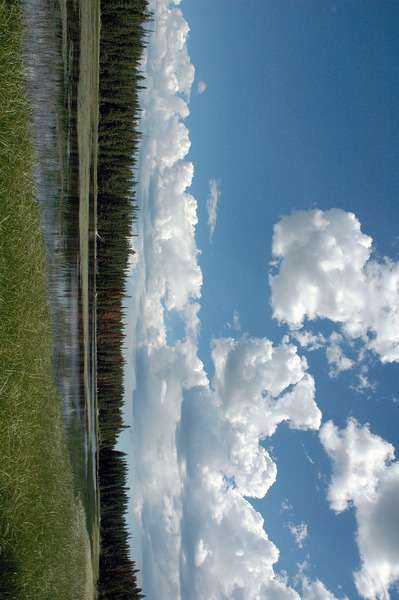

The test pattern stored on its side in a PNG and in a WebP, upright like
the first one on this page, red at the top left:

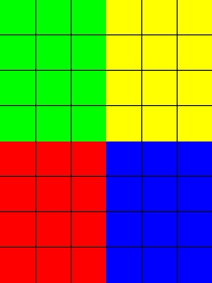


## JPEG variants

The lake as a baseline JPEG, a progressive one and a CMYK one, all as wide
as the text and with the same colours, then a file cut off halfway, whose
lower part is grey or smeared:


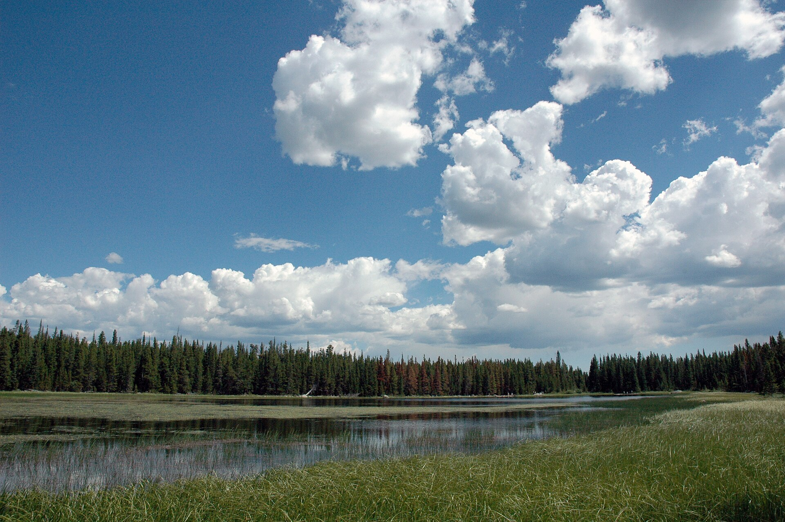


## PNG variants

Five small PngSuite images of about three cells each: 16-bit grey, an
8-bit palette, 16-bit colour with alpha, interlaced grey, and a palette
with a transparent background:


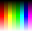

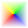

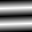

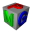

A lossy WebP, about 30 columns wide, and a lossless one of a grey noise
pattern:


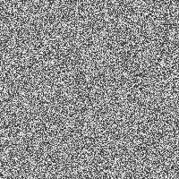

## Transparency

A red disc and a half-transparent blue square, with the background showing
around them and through the square:

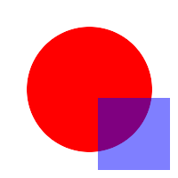

A compass rose without a background of its own, shrunk to the text width.
Its thin lines and points have clean edges, with no light or dark halo
around them on any background:

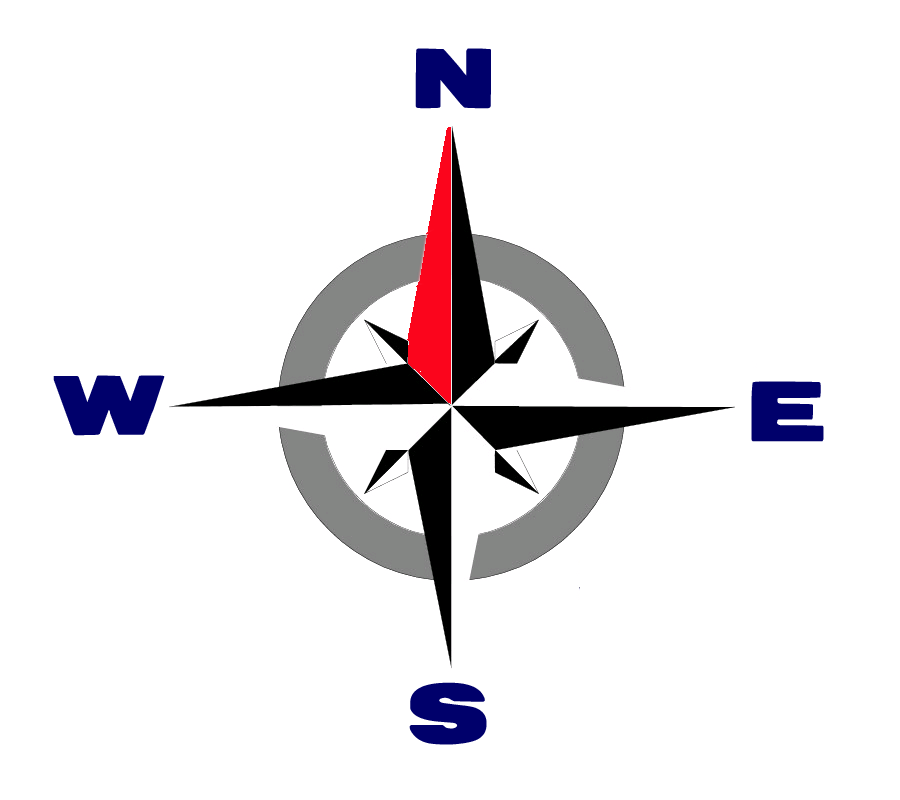

## Animations

In the pager an animated GIF, WebP or APNG shows its first frame with a play
button on it, and plays, in kitty and in Ghostty, when you start it. For a
moment after you start it, a white half circle turns in a dark disc in its
middle while its frames are made ready; then it plays. To start it, click on
it, or select it with Tab and press `p` or Enter. Tab scrolls to show the
whole picture: one partly below the window comes up until its bottom edge
is at the bottom, and one that is out of the window altogether is shown in
the middle of it. A second click or `p`
stops it, back on its first frame, and starting another animation stops the
one that plays. It plays as often as its file says, but at most 3 times
(`animation_plays` in the configuration file; 0 is without limit), and then
rests on its last frame, with a replay icon in its corner, until you click
it again. The status line tells what plays, in a pill at its right: a mark,
the alt text, a bar of one play and the time, as `3.2 / 8.0 s`. While the
pill is there the key hints (`? help`, `q quit`) are left out of the line;
they come back when a second Esc takes the pill off. Scrolling stops it too.
The horse below is Muybridge's race horse, 15 frames of a tenth of a second:
a galloping horse with its rider, for a second and a half, and then it
stands in its last pose.

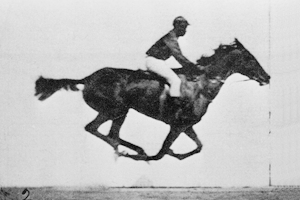

Printed, with `-P`, an animation shows its first frame. The same image alone,
which fits the window:

```sh
kiri tests/fixtures/images/muybridge-race-horse.gif
```

Reading mode (`M`, the default view) plays them too, though it draws a
picture into the page: the part of the page that holds the picture is the
animation, drawn again with each frame. tmux shows the first frame.
Four more animations play in the pager as the horse does, when started: a square that
turns from red to green to blue, from a GIF and from a WebP, a green puzzle
piece with eyes that jiggles, from an animated GIF, and a bouncing beach
ball, from an animated PNG.

The four below are close together, in the same stretch of the page in reading
mode: click one, and it plays while the others stay on their first frame;
click another, and the first goes back to its first frame and the second plays.
Two animations never play at once, in either layout.

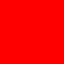


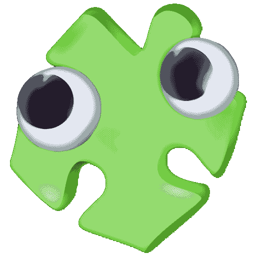

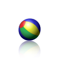

An animation in a table that scrolls sideways, or in a line of text, does not
play in reading mode: it shows its first frame, where it once showed an empty
space. Try it with `kiri --wide scroll examples/S06a-images.md`: the puzzle
piece below sits in a cell of a table too wide for the window, which scrolls
with ← and → (the table is the topmost band on the screen, so it is selected).
The header is why it is wide: its words, in alternating case, are joined
without spaces, so that each cell is one unbroken word and cannot wrap.

| ThIsHeAdErIsSoLoNgBeCaUsEiTiSaPaRtOfThEpArAgRaPhBeFoReItWrItTeNwItHoUtSpAcEsSoThAtThEtAbLeCaNnOtWrApAnDhAsToScRoLlSiDeWaYs | ScRoLlThEtAbLeSiDeWaYsWiThThEaRrOwKeYsToSeEtHeCeLlWiThThEpUzZlEpIeCeAnDtHeWoRdBeSiDeIt |
|---|---|
|  | and a word beside it |

## SVG

SVG images are drawn at the size they are shown, with sharp edges: the test
pattern without its grid, a sunset in gradients about 36 columns wide, and
a small soccer ball:

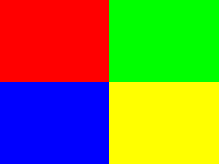

The same pattern again, from a file compressed with gzip:


Their text is set in the system's fonts: the forces on an airfoil, labelled
in Greek in a sans-serif font, and a gearset diagram with English labels in
the default serif font. The labels and arrows are black on a transparent
background, as in a browser, so they show only on a light background: a
light terminal, `--light`, or another theme with a light `background`.

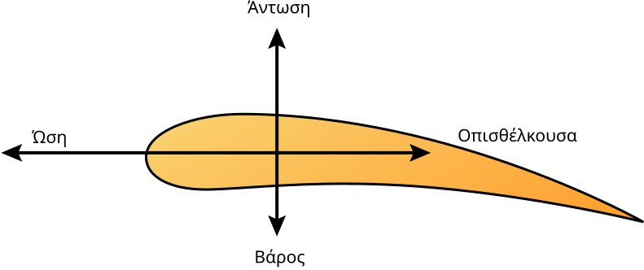

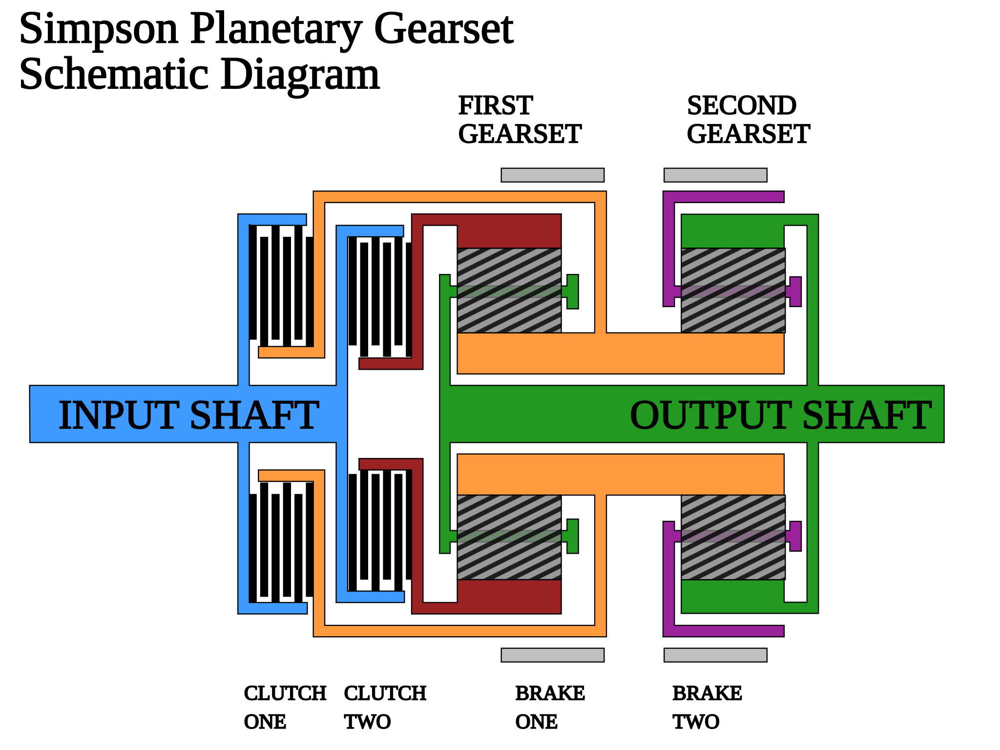

A racetrack in black lines with numbered corners, which also needs a light
background, and a silhouette with softly blurred edges, both as wide as the
text:

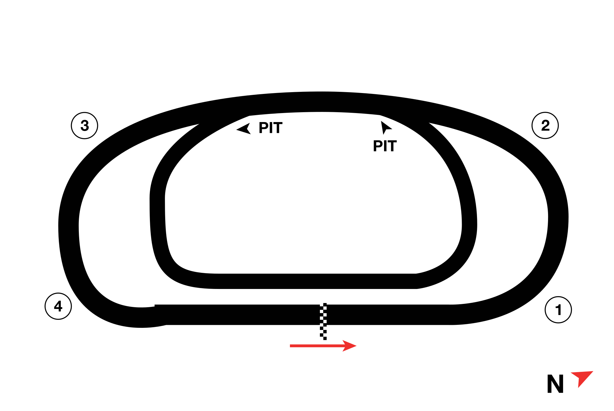


## More formats

The full build, the default, also shows BMP, TIFF, QOI, PNM, TGA and ICO
images. The test pattern five times, as a BMP, a TIFF, a QOI image, a PPM
and a TGA, each like the first one on this page, then the red disc and
half-transparent blue square from the transparency section, from an icon
file. Each comes under a heading that names its format. A build without
default features shows their alt text instead, and warns about each of
them:

### BMP

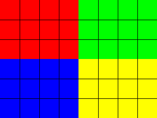

### TIFF, compressed with Deflate


### QOI


### PPM, one of the PNM formats


### TGA, recognised by its file name


### ICO


## Lists, quotes and links

Images in a list and a quote start after the bullet and the bar, and the
bar runs beside every row of the image:

- 

- An item with text, then an image lined up with the text:

  

> 

> > 

A linked image shows, but clicking it does nothing yet:

[](https://example.com)

## HTML images

An `` on a line of its own shows like a Markdown image: the checkered
icon of about two cells.


A logo wrapped and centred the way READMEs do it shows at the left edge, as
kiri does not centre images: the test pattern, half its size, about 16
columns wide and 6 rows high, keeping its shape.

<p align="center">
  
</p>

The test pattern squashed to 16 columns and 2 rows:


The icon enlarged to about 7 columns and 4 rows, a little soft:


The panorama at half the text width:


A `<picture>` shows its ``, the red disc and blue square, never its
`<source>`, a tall gradient:

<picture>
  <source media="(prefers-color-scheme: dark)" srcset="../tests/fixtures/images/portrait.png">
  
</picture>

A linked icon shows, but clicking it does nothing yet:

<a href="https://example.com"></a>

## In running text

An image in the middle of a line is drawn in the line's cells, on the text's
line. A small one keeps its size: the icon in  this
sentence is two cells wide, and the line is one row high, like the others.
So is the icon in a link, [ with
words](https://example.com), and each of two images side by side:
 

A badge, an image at most one row high and more than twice as wide, keeps its
shape:  is
the panorama as a strip, 160 pixels wide and one row high, standing in the
line.

An image a little too high for the row is shrunk into it, keeping its shape:
 is the compass rose, a
little smaller than the text's row is high.

A tall image makes its line higher: the rows above the text hold the image,
with its bottom on the text's baseline, and the text sits on the lowest of
them. Here  the test pattern is five rows high, and
these words are on the last.

## Alt text

One in a table cell still shows its alt text in brackets instead of an image,
for now. An image in a heading is drawn in the heading's rows, as the icon
here is, at its own size with its bottom on the bottom of the heading's row:

### A heading with 

| Image | Note |
|---|---|
|  | Alt text in a table |

A missing file, a file that is no image, a broken SVG, an image with too
many pixels and a remote image show their alt text, and kiri warns about
each of them on stderr:


## In reading mode

With `--reading` an image is in the page at its natural size in CSS
pixels, one pixel to a pixel of the text's 16, and shrunk to the column
when it is wider. An image in the middle of a line stands in the line, on
its baseline, as the badge here does: .
The text layout above draws such images in the line's cells instead, fitted to the
rows by its own rules. An image that cannot be shown is its alt text in grey.

```sh
kiri --reading examples/S06a-images.md
```
