# Diagrams

A document for checking kiri's diagrams by eye in a real kitty window. Each
section says what you should see there with the default theme; anything else
is a bug. How to view it with the themes and without colours is in
[README.md](README.md):

```sh
kiri examples/S07a-diagrams.md
```

## A diagram in a code block

A Mermaid diagram in a code block is drawn as an image in kitty, as GitHub
draws it, and stays code elsewhere and with `--no-images`. This flowchart
runs top to bottom: a rounded box, then a box titled "Saunan lämmitys"
around four steps. From its diamond, the arrow "ei" leads to "Lisää
puita" and another arrow back up, and the arrow "kyllä" leaves the box
for a rounded box at the end. On a light page the boxes are lavender with
dark text; on a dark page they are dark grey with light text. The letters
ä and ö show, the labels sit on their arrows, and no text is cut off.


## A diagram that chooses its own theme

kiri draws a diagram for the page it lies on: Mermaid's `default` theme,
dark text on light boxes, on a light page, and its `dark` theme on a dark
one. The page is light with `--light`, dark with `--dark`, and otherwise
as your terminal's background is; when that is not known it counts as
dark. A diagram can choose a theme of its own, with a directive on its
first line, and keeps it. One whose colours are for the other page would
have lines and text that cannot be seen, so it lies on a panel of its
own background, a little wider than the diagram on every side. The first
diagram below chooses `dark` and the second `default`, so one of them is
on a panel on either page, and the other is drawn like any diagram:

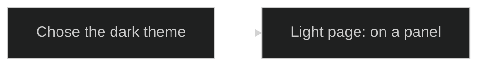

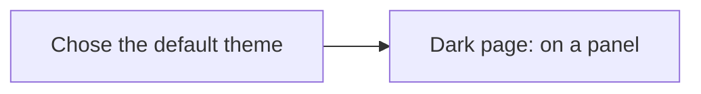

On a light page the first diagram lies on a dark grey panel and the second
needs none; on a dark page the second lies on a white panel and the first
needs none. The diagram on a panel is a little larger than the other, by
the width of the panel's edge. A diagram that needs no panel has the page
behind it:

```sh
kiri --light examples/S07a-diagrams.md
kiri --dark examples/S07a-diagrams.md
```

`background_panel = false` in the `[diagrams]` table of the configuration
file, `--diagram-panel off` or `KIRI_DIAGRAM_BACKGROUND_PANEL=off` leaves the
panels out: run `kiri --diagram-panel off examples/S07a-diagrams.md` and the
diagram for the other page loses its panel, so its lines and text may be
hard to see. See [Diagrams](../docs/diagrams.md).

## A diagram that fails to draw

A diagram that cannot be drawn stays code. The one below cannot, because
its last arrow leads nowhere:

```mermaid
flowchart LR
    Start --> Middle
    Middle -->
```

Below the code, in red, kiri says why, in lines that start with a cross
and "mermaid diagram could not be drawn". They start at the left edge of
the code's box and are no wider than it, so a long reason wraps. A
warning on standard error says the same, and names the diagram by its
line in the document. By default you get both; `--render-errors` chooses
one of them:

```sh
kiri --render-errors inline examples/S07a-diagrams.md
kiri --render-errors stderr examples/S07a-diagrams.md
kiri --mode kitty --render-errors stderr examples/S07a-diagrams.md >/dev/null
```

With `inline`, the red lines show and there is no warning. With `stderr`,
the diagram is code alone and the warning is on standard error. The last
command shows only that warning, `kiri: mermaid diagram on line …: …`,
and nothing of the document.

## One diagram of each type

One small diagram of each common Mermaid type, as kiri draws them. On
GitHub the same blocks are drawn as diagrams too, so the two can be
compared side by side. Each diagram is also a file of its own in
[mermaid/](mermaid/), which kiri shows on its own, fitted to the window,
and shows as source with `--format text`:

```sh
kiri examples/mermaid/flowchart.mmd
kiri --format text examples/mermaid/flowchart.mmd
```

The file [S07b-flowchart.mmd](S07b-flowchart.mmd) is a flowchart of its own
in this directory, so that `kiri examples/S*` shows it among the other
files. Its boxes run from top to bottom. From its diamond, the arrow "no"
leads to "Wait a while" and another arrow back up, and the arrow "yes"
leads on to a database-shaped box at the end:

```sh
kiri examples/S07b-flowchart.mmd
```

View the document on the light and dark paper themes too. On a light
page the diagrams use Mermaid's `default` theme, lavender boxes with
dark text; on a dark page its `dark` theme, dark grey boxes with light
text. No text is cut off, and the letters ä and ö show.

### Flowchart

Boxes joined by arrows, here a push's way through continuous
integration, with a subgraph, labelled arrows, a dotted arrow back to the
start and a database-shaped node. Source:
[flowchart.mmd](mermaid/flowchart.mmd).

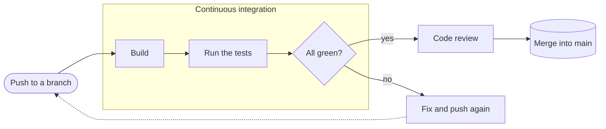

### Sequence diagram

Messages between participants over time: a login with numbered steps, an
activation bar, notes and an alternative for a wrong password. Source:
[sequence.mmd](mermaid/sequence.mmd).

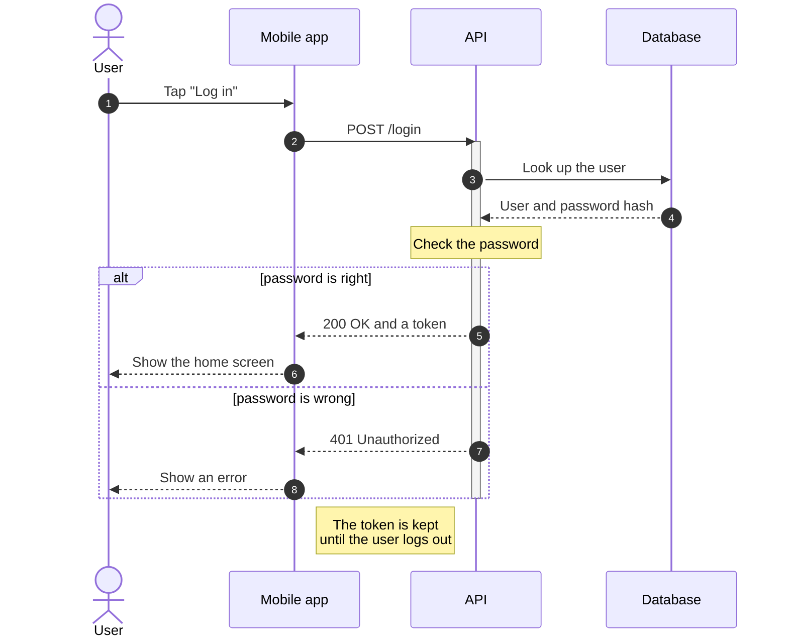

### Class diagram

Classes with fields and methods and how they relate: a small library in
Finnish, with an interface, multiplicities and labelled associations.
Source: [class.mmd](mermaid/class.mmd).

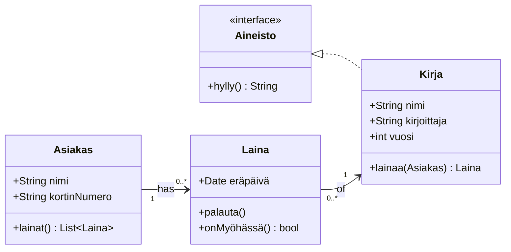

### State diagram

States and the events that move between them: a pull request, with a
nested state and a note. Source: [state.mmd](mermaid/state.mmd).

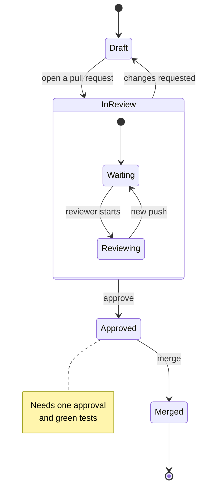

### Entity relationship diagram

Tables of a web shop, their columns and keys, and crow's-foot relations
between them. Source: [er.mmd](mermaid/er.mmd).

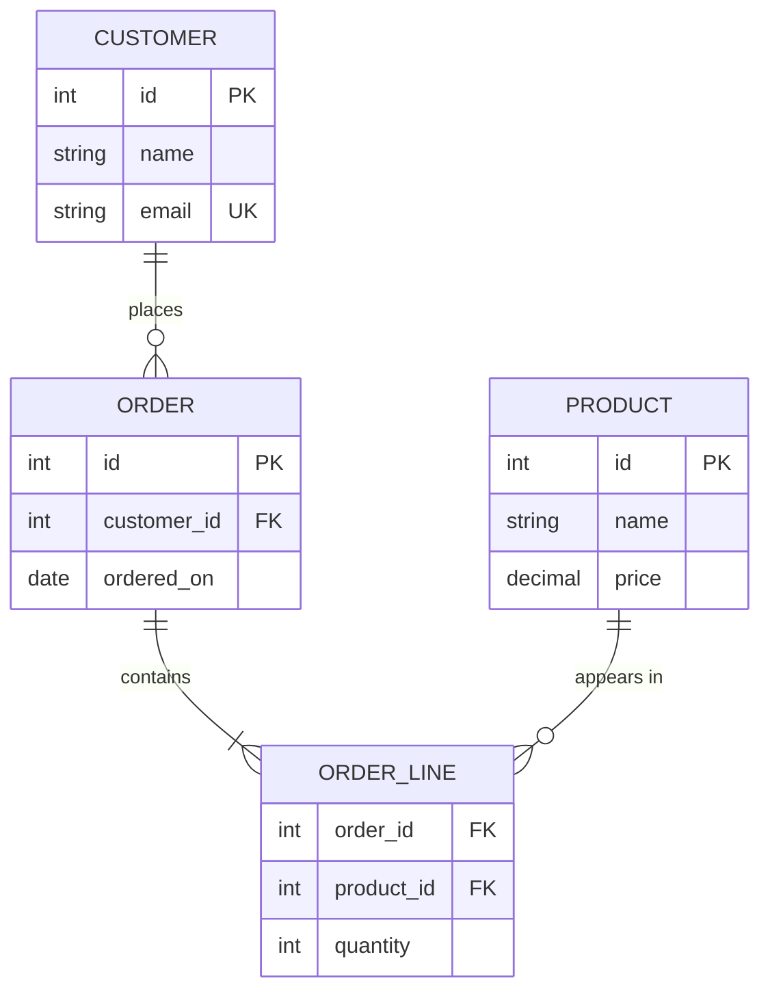

### Gantt chart

Tasks on a calendar: a summer cottage renovation in Finnish, with finished
and active tasks, dependencies and a milestone. Source:
[gantt.mmd](mermaid/gantt.mmd).

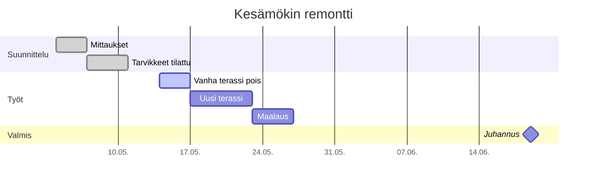

### Pie chart

Shares of a whole, with the values shown in the legend. Source:
[pie.mmd](mermaid/pie.mmd).

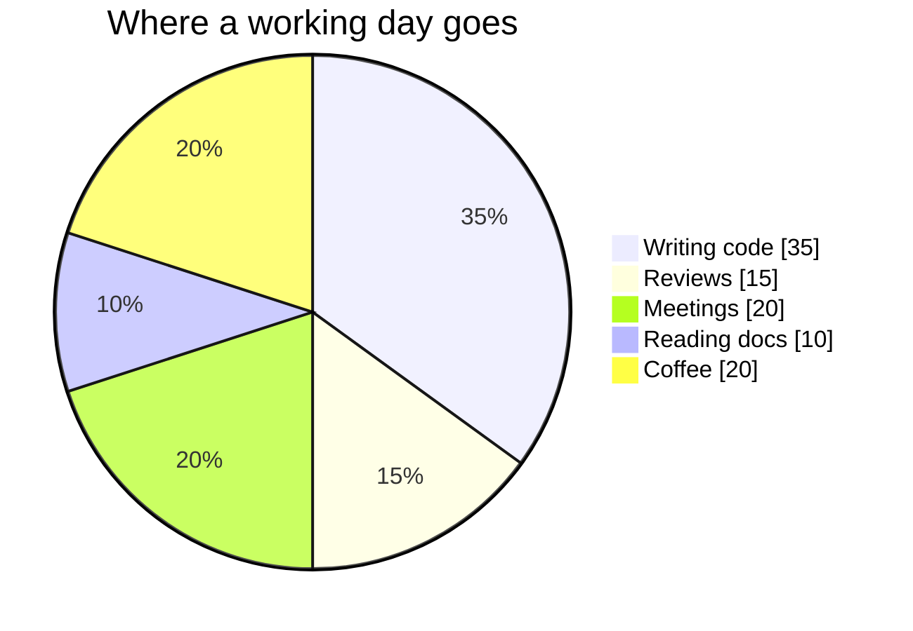

### Mind map

Ideas branching from a centre: household chores in Finnish. Source:
[mindmap.mmd](mermaid/mindmap.mmd).

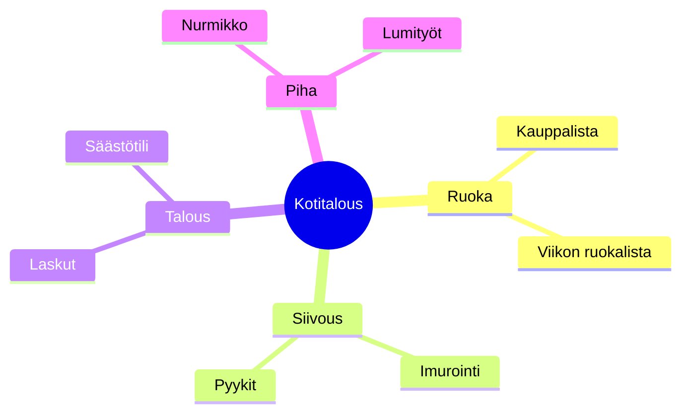

### Timeline

Events by period, grouped into sections. Source:
[timeline.mmd](mermaid/timeline.mmd).

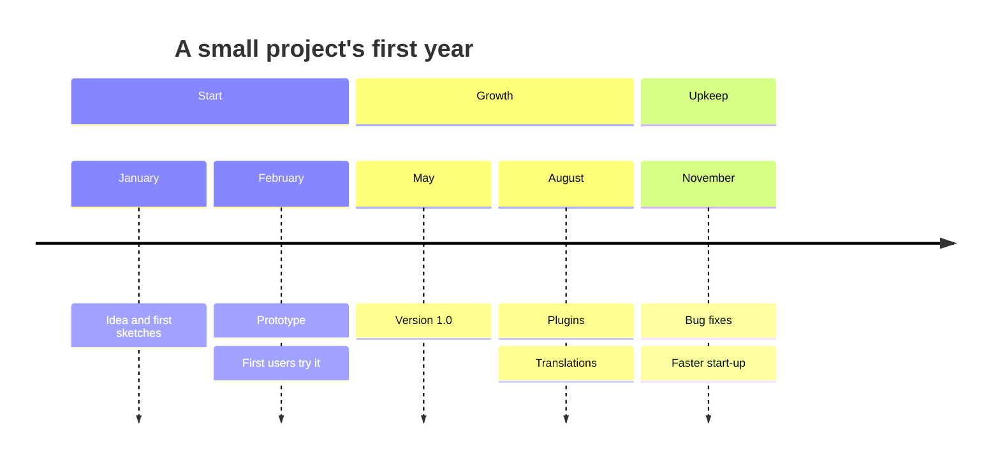

### Git graph

Commits, branches, a merge and a tag. Source:
[gitgraph.mmd](mermaid/gitgraph.mmd).

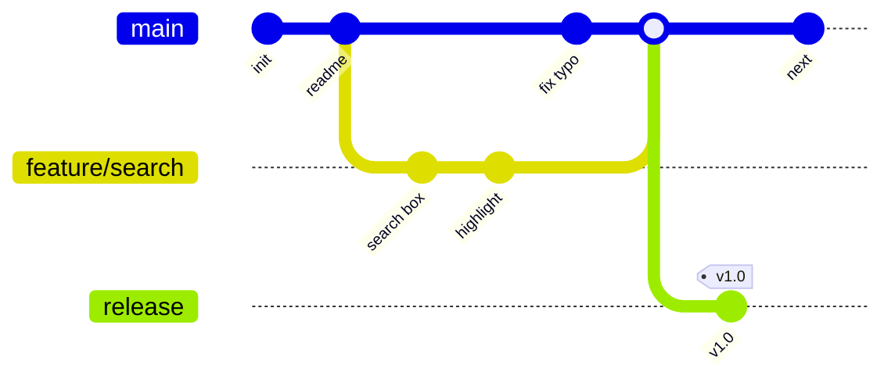

## In reading mode

With `--reading` a diagram is in the page at the left of the column, as it
is here, and shrunk to the column when it is wider.

```sh
kiri --reading examples/S07a-diagrams.md
```
