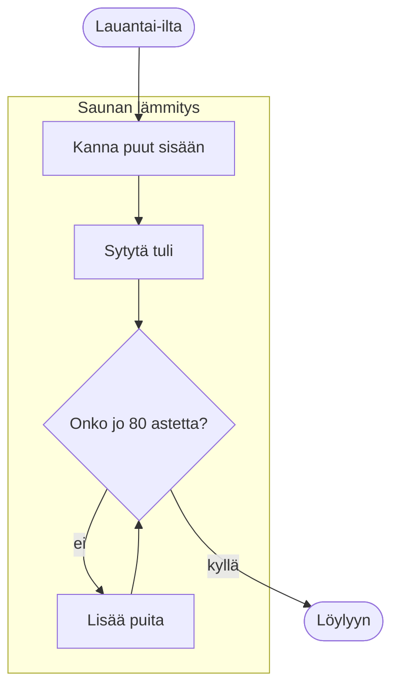

# Diagrams

A document for checking kiri's diagrams by eye in a real kitty window. Each
section says what you should see there with the default theme; anything else
is a bug. How to view it with the themes and without colours is in
[README.md](README.md):

```sh
cargo run -- examples/S07a-diagrams.md
```

## A flowchart

A Mermaid diagram in a code block is drawn as an image in kitty, as GitHub
draws it, and stays code elsewhere and with `--no-images`. This flowchart
runs top to bottom: a rounded box, then a box titled "Saunan lämmitys"
around four steps. From its diamond, the arrow "ei" leads to "Lisää
puita" and another arrow back up, and the arrow "kyllä" leaves the box
for a rounded box at the end. On a light page the boxes are lavender with
dark text; on a dark page they are dark grey with light text. The letters
ä and ö show, the labels sit on their arrows, and no text is cut off.


