# Diagrams

Each section says what to look for; anything else is a bug. Themes and
colourless output: [README.md](README.md):

```sh
kiri examples/S07a-diagrams.md
```

## A diagram in a code block

A Mermaid diagram in a code block is drawn as an image in kitty, as GitHub
draws it, and stays code elsewhere and with `--no-images`. This flowchart
runs top to bottom, with a box titled "Saunan lämmitys" around four steps.
From its diamond, "ei" leads to "Lisää puita" and back up, and "kyllä"
leaves the box for the last one. The boxes are lavender on a light page
and dark grey on a dark one. The letters ä and ö show, the labels sit on
their arrows, and no text is cut off.

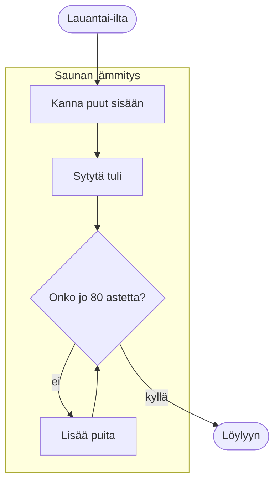

## A diagram that chooses its own theme

kiri draws a diagram for the page it lies on: Mermaid's `default` theme on
a light page and its `dark` theme on a dark one. A diagram can choose a
theme with a directive on its first line and keeps it; one made for the
other page lies on a panel of its own background, a little wider than the
diagram. The first diagram below chooses `dark` and the second `default`,
so on either page one of them is on a panel:

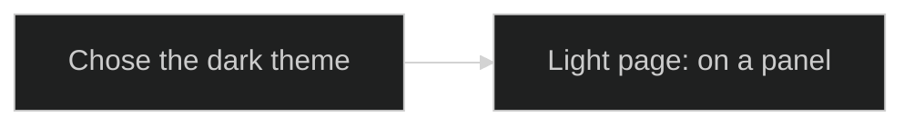

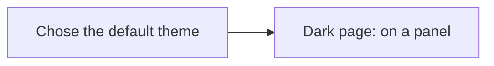

On a light page the first lies on a dark grey panel, on a dark page the
second on a white one, and the other has the page behind it:

```sh
kiri --light examples/S07a-diagrams.md
kiri --dark examples/S07a-diagrams.md
```

`--diagram-panel off`, `KIRI_DIAGRAM_BACKGROUND_PANEL=off` or
`background_panel = false` in the `[diagrams]` table leaves the panels out,
and the diagram for the other page is then hard to see. See
[Diagrams](../docs/diagrams.md).

## A diagram that fails to draw

A diagram that cannot be drawn stays code. This one cannot, because its
last arrow leads nowhere:

```mermaid
flowchart LR
    Start --> Middle
    Middle -->
```

Below the code, in red, kiri says why, in lines that start with a cross
and "mermaid diagram could not be drawn". They are no wider than the code's
box, so a long reason wraps. A warning on standard error says the same and
names the diagram by its line. By default you get both; `--render-errors`
chooses one:

```sh
kiri --render-errors inline examples/S07a-diagrams.md
kiri --render-errors stderr examples/S07a-diagrams.md
kiri --mode kitty --render-errors stderr examples/S07a-diagrams.md >/dev/null
```

With `inline` there is no warning; with `stderr` the diagram is code alone.
The last command shows only the warning, `kiri: mermaid diagram on line
…: …`.

## One diagram of each type

One small diagram of each common Mermaid type, to compare with GitHub's
drawing of the same blocks. Each is also a file of its own in
[mermaid/](mermaid/), which kiri shows fitted to the window, and as source
with `--format text`:

```sh
kiri examples/mermaid/flowchart.mmd
kiri --format text examples/mermaid/flowchart.mmd
```

[S07b-flowchart.mmd](S07b-flowchart.mmd) is a flowchart of its own here,
so that `kiri examples/S*` shows it among the other files. From its
diamond, "no" leads to "Wait a while" and back up, and "yes" leads to a
database-shaped box at the end:

```sh
kiri examples/S07b-flowchart.mmd
```

View the document on `--light` and `--dark` too. No text is cut off, and
the letters ä and ö show.

### Flowchart

A push's way through continuous integration, with a subgraph, labelled
arrows, a dotted arrow back and a database-shaped node:
[flowchart.mmd](mermaid/flowchart.mmd).

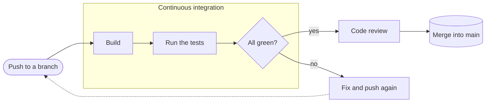

### Sequence diagram

A login with numbered steps, an activation bar, notes and an alternative
for a wrong password: [sequence.mmd](mermaid/sequence.mmd).

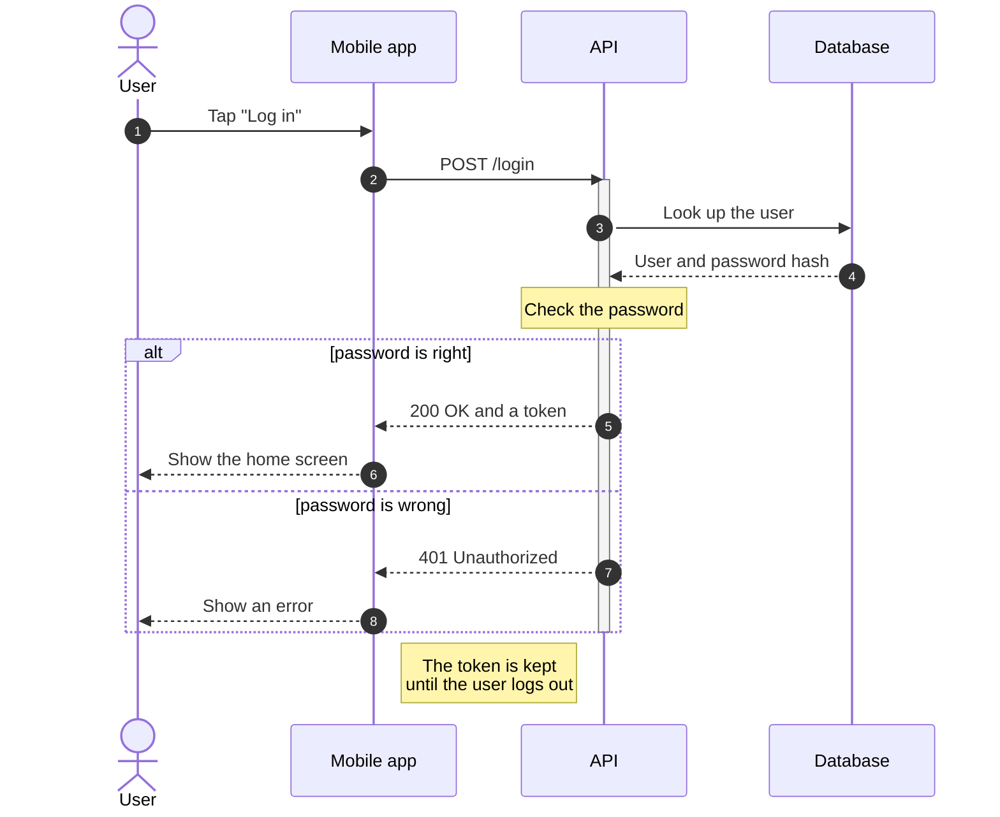

### Class diagram

A small library in Finnish, with an interface, multiplicities and labelled
associations: [class.mmd](mermaid/class.mmd).

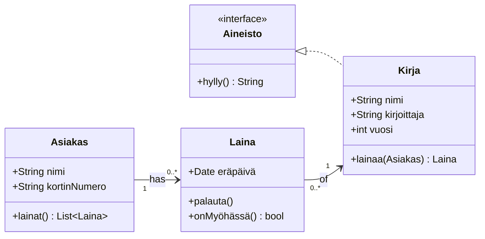

### State diagram

A pull request, with a nested state and a note:
[state.mmd](mermaid/state.mmd).

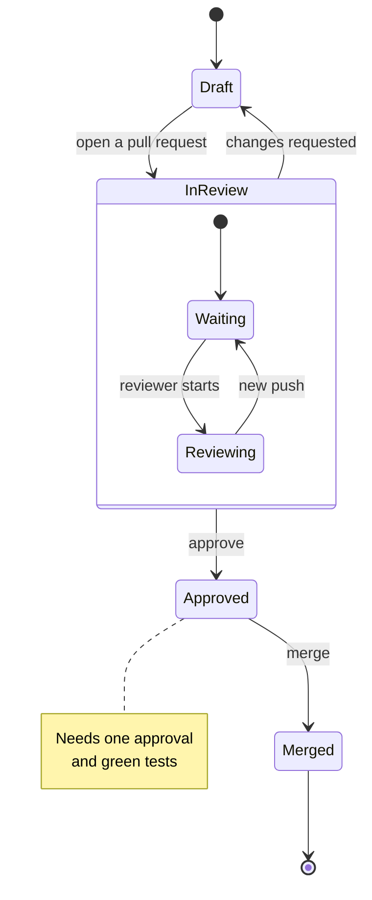

### Entity relationship diagram

A web shop's tables, columns, keys and crow's-foot relations:
[er.mmd](mermaid/er.mmd).

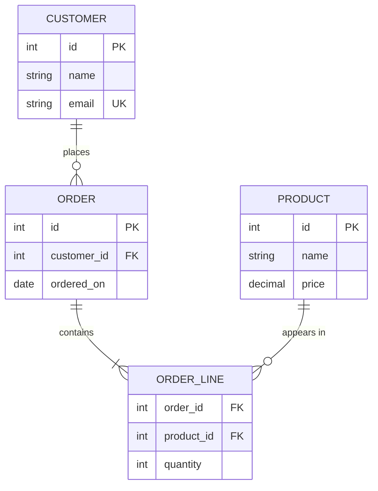

### Gantt chart

A cottage renovation in Finnish, with finished and active tasks,
dependencies and a milestone: [gantt.mmd](mermaid/gantt.mmd).

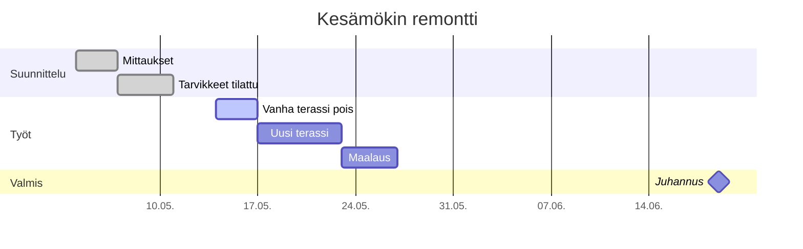

### Pie chart

Shares of a whole, with the values in the legend: [pie.mmd](mermaid/pie.mmd).

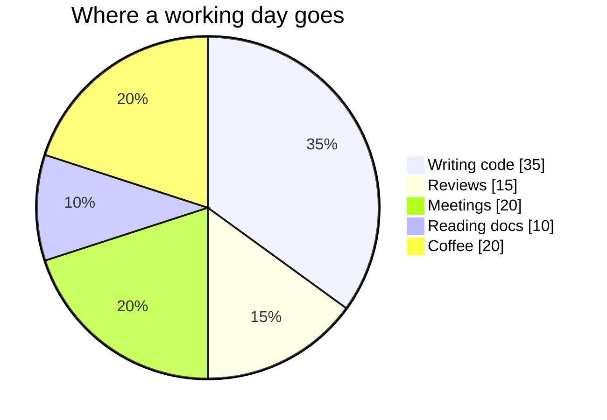

### Mind map

Household chores in Finnish, branching from a centre:
[mindmap.mmd](mermaid/mindmap.mmd).

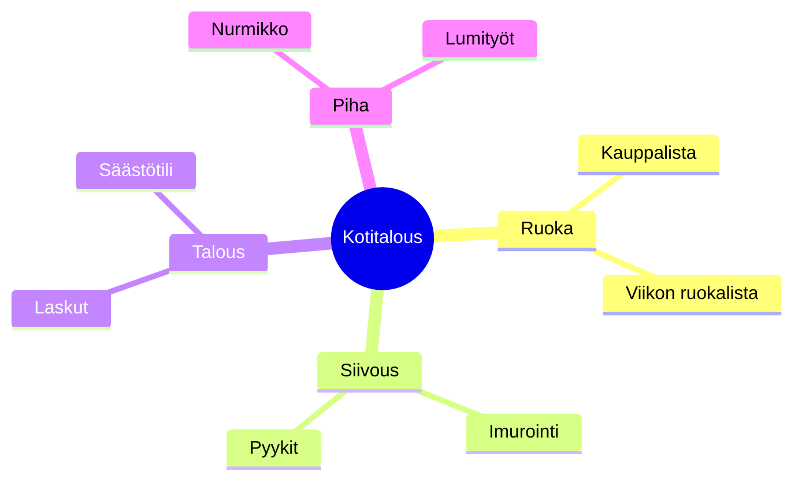

### Timeline

Events by period, in sections: [timeline.mmd](mermaid/timeline.mmd).

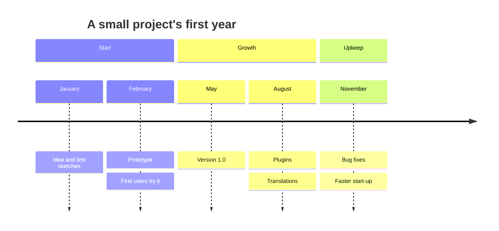

### Git graph

Commits, branches, a merge and a tag: [gitgraph.mmd](mermaid/gitgraph.mmd).

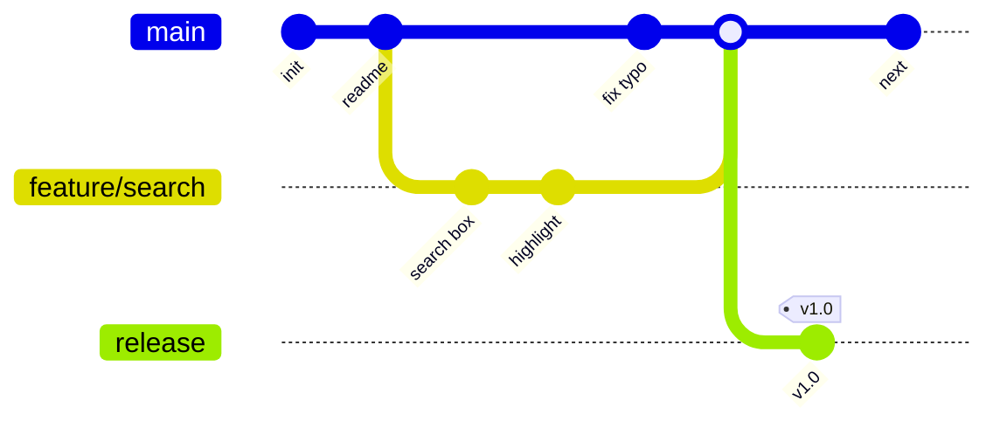
