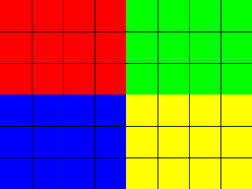
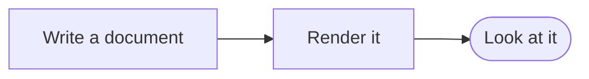

# Reading mode

A document for checking reading mode by eye in a real kitty window. Each
section says what to look for; anything else is a bug. Reading mode is
experimental, and its option's name may still change:

```sh
kiri examples/S09-reading-mode.md
kiri --light examples/S09-reading-mode.md
kiri --dark examples/S09-reading-mode.md
kiri --wide scroll examples/S09-reading-mode.md
kiri --zoom 1.5 examples/S09-reading-mode.md
kiri --no-reading examples/S09-reading-mode.md
```

Reading mode is what plain `kiri` shows in a terminal that draws images;
`--no-reading` gives the text layout that `README.md` describes.
`M` in the pager turns reading mode on and off and keeps the same block at
the top; the status line says `M reading` while it is on.

The text is in the system's sans-serif font in a column of at most 42 times
a row's height, at the left of an area half as wide again, where code blocks
and tables may reach. Images, diagrams, formulas and alerts stay in the
column. The front matter above is a table in the proportional font;
`S03a-tables.md` has nested ones. The text cannot be selected, as it is
drawn as images. The page is transparent unless the theme has a background
colour. `B` paints the terminal's background colour across the whole window
and `B` again takes it away; with `--dark`, `B` takes the theme's background
away.

## Text

A paragraph with *emphasis*, **strong text**, ~~strikethrough~~, inline
code such as `make check`, a key such as <kbd>Ctrl</kbd>, and
[a link](https://example.com) in blue, without an underline. Inline code
breaks only at its spaces: a long one such as `src/render/reading.rs` or
`--reading-mode-experimental-flag` moves to the next line whole.

Other scripts: Привіт, Ελληνικά, 日本語のテキスト, العربية and עברית.
Emoji are in colour: 🎉, 🦀 and 😀; a © stays text.

A line break inside a paragraph,\
starts a new line here.

---

Above, a thematic break across the column.

## Headings

The six levels at GitHub's sizes, levels one and two with a rule under
them.

# Level one

## Level two

### Level three

#### Level four

##### Level five

###### Level six

## Lists

Markers are right-aligned before the text: discs, circles, then squares.

- An item
- An item long enough to wrap onto a second line in a window of usual
  width
  - A nested item, with a circle
    - Deeper still, with a square

1. A numbered item
2. Another one
3. The numbers end at the same place, also at ten:
4. Four
5. Five
6. Six
7. Seven
8. Eight
9. Nine
10. Ten

- [x] A finished task, with a blue box and a white tick
- [ ] An open task, with a grey outline

## Quotes

> A quote has a grey bar and grey text.
>
> A second paragraph, under the same bar.

## Code

A code block is as wide as the text, or as its longest line up to the
area's right edge:

```rust
fn main() {
    println!("Hello, kiri");
}
```

```sh
kiri --theme examples/themes/background.toml examples/S09-reading-mode.md
```

A line longer than the area wraps at the area's edge:

```text
This line is long enough to be wider than the area in a window of usual width, so that it wraps at the right edge of the area and goes on below, to findme.
```

## Tables

A table has a bold header, thin borders and every second body row shaded.
A small table is as wide as its content:

| Name | Kind | Count |
|:-----|:----:|------:|
| Fern | plant | 12 |
| Crab | animal | 7 |
| Moss | plant | 30 |

The middle column is centred and the last one aligned right.

A wider table reaches past the text into the area, and its cells wrap as
a browser's do, the longer text getting more room:

| Element | Notes |
|---------|-------|
| Headings | Drawn at GitHub's sizes in the system's sans-serif font, with a rule under the two largest levels, and further from the text above them than from the text below. |
| Tables | As wide as their content up to the right edge of the area, with `inline code` and [links](https://example.com) in their cells as in a paragraph. |

A table too wide even with its cells wrapped at every space breaks its
long words, so that it fits the area:

| Path | Another path |
|------|--------------|
| `src/render/reading/a_very_long_module_name_that_does_not_fit.rs` | `src/reading/page/another_very_long_name_that_cannot_fit_either.rs`findme and then a few more words that push the next one far to the right [link](https://example.com/band) |

## Scrolling sideways

By default the long code line and the too wide table above wrap, also in
the pager. With `--wide scroll`, or after `W`, they keep their lines whole
instead, each in a band that scrolls sideways, as wide as the area, with a
thin scroll bar under it and a fade on each edge that has more beyond it.
Printing always wraps.

The topmost band on the screen is selected, with a brighter, thicker bar. A
click selects the band under it, and so does a search that finds something
in another. ← and → scroll the selected band a little, `H` and `L` by most
of its width, and the sideways wheel, or the wheel with Shift, the band
under the pointer. A code band's language stays in its top right corner.
`W` again wraps them and keeps the same block at the top.

## Search and links

`/` searches the text of a page as in the text layout: matches are boxes
with the text over them, black on yellow, and the current one black on
orange with the default theme, in reverse without colour. `n` and `N` move
between them and the status line counts them. Open this document with
`--wide scroll` and search for `findme`: the first match is at the end of
the long code line, past its right edge, so that band scrolls to it and is
selected; `n` goes to the second, at the end of the second path in the wide
table, whose band then scrolls in turn; the third is in this paragraph.
Without `--wide scroll` nothing scrolls.

Search looks in the document's text, not in what kiri adds to show it: it
finds a term in a table cell, in the front matter and across the end of a
line, as in the text layout. Search for `experimental`: the first match is
in the front matter's tags, the second in the first paragraph. It does not
find list bullets and numbers, an alert's kind, a code block's language or
the alt text of a picture that is drawn.

The links in a page are links for kitty, as in the text layout:
[a link to the examples](https://example.com/), and [one broken over the
end of a line, with a long text that wraps onto the next line](https://example.org/).
A picture in a link is one too, inline here,
<a href="https://example.net/inline"></a> in the middle of a
line, and alone on its line:

<a href="https://example.net/alone"></a>

Tab, Shift+Tab, Enter and Escape select, copy and release links as
`S01-text.md` describes, with a box round the selected link in place of
reverse video. This includes the badges above, and the wrapped link stays
selected when you scroll its first line away. Enter also copies in tmux when
it passes images through, and the status line says `link copied`.

An address too long for the status line is cut in the middle with `…`, so
that both ends show, as with
[a link with a long address](https://example.com/a/very/long/address/that/does/not/fit/on/the/status/line/of/a/window/of/usual/width/index.html?with=a&query=string):
the status line begins with `https://example.com/` and ends with
`query=string`.

With `--wide scroll`, Tab reaches the links in a band too, also while the
band is scrolled so that the link is out of its view: the last cell of the
wide table has one, "link", beyond the band's right edge at first. Tab
selects it after the links above it and scrolls the band until it is in
view, with its box round it.

## Images, diagrams and formulas

An image is in the page at its natural size, as in a browser, and shrunk
to the column when it is wider: the test pattern below is about 320 pixels
wide. A CSS pixel grows with the text at a taller cell:


A formula is in the middle of the column, in the text's colour, and a
diagram at the left:

```math
\frac{n(n+1)}{2}
```



An image in the middle of a line, such as this one of 24 pixels
 or two badges in a
row  , stands on the line's
baseline and makes the line taller if it is taller. After `r`, or an
automatic reload, such an image is loaded again if its file changed:
replace `S06b-pattern.png` with another picture, press `r`, and the badge
shows the new one. Put the file back afterwards with
`git checkout examples/S06b-pattern.png`.

A formula in the middle of a line, such as $\frac{a}{b}$ or $x^2 + y^2$,
is drawn in text style at the size of the text, in its colour: the
fraction's bar is at the height of the text's minus sign, and its
denominator reaches below the line. Dollar signs that are not math by
GitHub's rules, as in "it costs $5 and $10", stay text. The text layout
shows the formulas as their source.

An image that cannot be shown, such as the missing one in
[S06a-images.md](S06a-images.md), shows its alt text in grey.

## Alerts

An alert has a bar in the kind's colour down its left edge, a tint behind
it, and a bold title after the kind's icon. The text under it is in the
text's colour, and inline code in it has a stronger tint. Any blocks may be
inside it, such as a list or a code block:

> [!NOTE]
> A note: blue, with an icon. Some `inline code` in it, and a list:
>
> - one item
> - another

> [!WARNING] A title of its own
> Yellow, with a triangle.

## Details and HTML

A `<details>` block is its summary in bold after a triangle, and what is
inside it below, always shown:

<details>
<summary>The summary, in bold</summary>

What is inside: a paragraph, in the text's colour,

- and a list.

</details>

Raw HTML that kiri does not draw is its source in the code's font, muted:

<div>
  <b>HTML</b>
</div>

The text goes on below it in the proportional font.

## Zoom

`z` makes the text and the pictures larger and `Z` smaller, a step at a
time from 50 % to 200 %, and the status line says `zoom: 125 %` for a
moment. Ctrl with the mouse wheel does the same, a notch up as `z`, if your
terminal passes it on; in the text layout it only scrolls. Everything in the column grows together, as when a browser zooms a
page: the text, the headings, the code, the test pattern above and the
formula, and the column and the area widen with them until the window is
full. The block at the top of the window stays at the top. `--zoom 1.5` or
`zoom = 1.5` in the configuration file starts at 150 %. The text layout
(`M`) does not change with the zoom.
