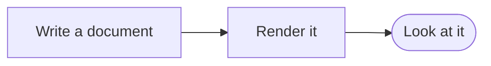

# Reading mode

A document for checking reading mode by eye in a real kitty window. Each
section says what you should see there with the default theme; anything
else is a bug. Reading mode is experimental, and its option's name may
still change:

```sh
kiri --reading examples/S09-reading-mode.md
kiri --reading --light examples/S09-reading-mode.md
kiri --reading --dark examples/S09-reading-mode.md
kiri --reading --wide scroll examples/S09-reading-mode.md
```

In the pager, `M` turns reading mode on and off, also without
`--reading`, and the same block stays at the top of the window. While
reading mode is on, the status line says `M reading` after the position;
the images and formulas in the middle of a line, such as those below,
load when `M` turns it on, if they were not loaded already.

Without `--reading` this document looks like the others. With it, the
headings, paragraphs, lists and quotes are in the system's sans-serif font
at about four fifths of a row's height, in a column 42 times that wide at
most, at the left of an area half as wide again in the middle of the
window. Code blocks and tables are drawn too, and may reach across the
area, and so are images, diagrams, formulas and alerts, in the column.
The front matter above is a table of its keys and values, as wide as the
column and a line below the top, in the proportional font, every second
row from the second shaded; `S03a-tables.md` has nested tables in it. The
text cannot be selected or copied, as it is drawn as images. With a theme
or terminal that gives the background's colour, the page is an opaque area
in that colour, so bold text in a shaded row looks as heavy as in an
unshaded one; with `background_opacity` below 1 in kitty it does not show
the window behind it.

## Text

A paragraph with *emphasis*, **strong text**, ~~strikethrough~~, inline
code such as `make check`, a key such as <kbd>Ctrl</kbd>, and
[a link](https://example.com) in blue, without an underline. Lines are one
and a half times the font size apart, also the lines with inline code,
whose grey chip sits a little lower than the line and has no padding
spaces around it. Inline code breaks only at its spaces: a long one such as
`src/render/reading.rs` or `--reading-mode-experimental-flag` moves to the
next line whole rather than breaking at a slash or a hyphen.

Other scripts come from fonts that have them: Привіт, Ελληνικά,
日本語のテキスト, العربية and עברית. Emoji are in colour: 🎉, 🦀 and 😀;
a © stays text.

A line break inside a paragraph,\
starts a new line here.

---

Above, a thematic break: a grey bar a quarter of the font size thick
across the column.

## Headings

Below, the six heading levels at GitHub's sizes: two, one and a half, one
and a quarter, one, seven eighths and 0.85 times the text, bold, and in
the heading colour. Levels one and two have a thin grey rule under them.
A heading is further from the text above it than from the text below it.

# Level one

## Level two

### Level three

#### Level four

##### Level five

###### Level six

## Lists

The markers are right-aligned just before the text, on the baseline of
the item's first line: discs, then circles, then squares deeper in.
Items in a tight list are half a line apart.

- An item
- An item long enough to wrap onto a second line in a window of usual
  width, whose second line starts under the first line's text
  - A nested item, with a circle
    - Deeper still, with a square

1. A numbered item
2. Another one
3. The numbers end at the same place, also at ten:
4. Four
5. Five
6. Six
7. Seven
8. Eight
9. Nine
10. Ten

- [x] A finished task, with a blue box and a white tick
- [ ] An open task, with a grey outline

## Quotes

> A quote has a grey bar down its left edge, and its text is grey and
> starts a little after the bar.
>
> A second paragraph in the same quote, under the same bar.

## Code

A code block starts at the text's left edge on a rounded background in
the colours of the code theme, highlighted as without reading mode, with
its language in grey in the top right corner. It is as wide as the text,
or as its longest line up to the right edge of the area:

```rust
fn main() {
    println!("Hello, kiri");
}
```

```sh
kiri --reading --theme examples/themes/background.toml examples/S09-reading-mode.md
```

A line longer than the area wraps at the area's edge, and goes on at the
code's left edge on the next line:

```text
This line is long enough to be wider than the area in a window of usual width, so that it wraps at the right edge of the area and goes on below, to findme.
```

## Tables

A table starts at the text's left edge, bold in its header, with thin
borders and every second body row shaded. A small table is as wide as
its content:

| Name | Kind | Count |
|:-----|:----:|------:|
| Fern | plant | 12 |
| Crab | animal | 7 |
| Moss | plant | 30 |

The middle column is centred and the last one aligned right.

A wider table reaches past the text into the area, and its cells wrap as
a browser wraps them, the longer text getting the more room:

| Element | Notes |
|---------|-------|
| Headings | Drawn at GitHub's sizes in the system's sans-serif font, with a rule under the two largest levels, and further from the text above them than from the text below. |
| Tables | As wide as their content up to the right edge of the area, with `inline code` and [links](https://example.com) in their cells as in a paragraph. |

A table too wide even with its cells wrapped at every space breaks its
long words where it must, so that it still fits the area:

| Path | Another path |
|------|--------------|
| `src/render/reading/a_very_long_module_name_that_does_not_fit.rs` | `src/reading/page/another_very_long_name_that_cannot_fit_either.rs`findme |

## Scrolling sideways

By default the long code line and the too wide table above wrap, also in
the pager. With `--wide scroll`, or after `W` in the pager, they keep
their lines and words whole instead, each in a band of its own that
scrolls sideways. A band is as wide as the area, with a thin grey scroll
bar under it, and fades out on each edge that has more beyond it: at
first only on the right. Printing always wraps.

One band is selected, the topmost on the screen, and its scroll bar is
brighter and thicker. A click selects the band under it, and so does a
search that finds something in another (see below). ← and →
scroll the selected band a little, `H` and `L` by most of its width, and
the sideways wheel, or the wheel with Shift, scrolls the band under the
pointer. Scrolled to the middle, a band fades out on both edges; at its
end, only on the left. A code band's language stays in its top right
corner as the code scrolls under it. `W` again wraps them, and the same
block stays at the top of the window.

## Search and links

In the pager, `/` searches the text of a page as it does in the text
layout: the matches are boxes with the text drawn over them, the others
black on yellow and the current match black on orange with the default
theme, in the theme's own colours where it sets them, and in reverse,
a box in the text's colour, without colour. `n` and `N` move between them
and the status line counts them. Open this document with `--wide scroll`
and search for `findme`: the first match is at the end of the long code
line near the top, past its right edge, so that band scrolls to the end
of its line, the match boxed, and is selected; `n` goes to the second, at
the end of the second path in the table too wide, whose band then scrolls
and is selected in turn (the first keeps where it was); the third is in
this paragraph. Without `--wide scroll` the code and the table wrap and
nothing scrolls.

The links in a page are links for kitty, as in the text layout, so it
opens one as it does there: [a link to the examples](https://example.com/),
and [one broken over the end of a line, with a long text that wraps onto
the next line](https://example.org/). A picture in a link is one too,
inline here, <a href="https://example.net/inline"></a> in the middle of a
line, and alone on its line:

<a href="https://example.net/alone"></a>

Tab selects the first link on the screen, and again the next, the badges
among them, Shift+Tab the one before: the selected link has a box round it
and the status line says where it goes. Escape lets it go.

## Images, diagrams and formulas

An image is in the page at its natural size, as in a browser, at the
text's left edge, and shrunk to the column when it is wider: below, the
test pattern is 32 characters wide, about 320 pixels. One CSS pixel is
one pixel of the page at the usual row, and grows with the text at a
taller cell:


A formula is in the middle of the column, in the colour of the text, and
a diagram at the left, as without reading mode:

```math
\frac{n(n+1)}{2}
```



An image in the middle of a line, such as this one of 24 pixels
 or two badges in a
row  , stands in the line on its
baseline, and makes the line taller than the text if it is taller.
After `r`, or when the pager reloads the file by itself, such an image
is loaded again if its file changed meanwhile, as an image on a line of
its own is: replace `S06b-pattern.png` with another picture, press `r`,
and the badge in the line shows the new one.

A formula in the middle of a line, such as $\frac{a}{b}$ or $x^2 + y^2$,
is drawn in the line in the colour of the text, as large as the text
and in text style, with its own baseline on the line's: the fraction's
bar is at the height of the text's minus sign, and its denominator
reaches below the line. Dollar
signs that are not math by GitHub's rules, as in "it costs $5 and $10",
stay text. Without reading mode the formulas show as their source.

An image that cannot be shown, such as the missing one in
[S06a-images.md](S06a-images.md), shows its alt text in grey where it
would be.

## Alerts

An alert is drawn in the proportional font in the column: a bar down its
left edge in the kind's colour, a tint of that colour behind it, and the
title in bold in the colour after the kind's icon, a circle with an `i`
here. The text under it is in the text's colour, and inline code in it
has a stronger tint behind it. Any blocks may be inside it, such as a
list or a code block, in the room that is left:

> [!NOTE]
> A note: blue, with an icon and the bold title "Note". Some `inline
> code` in it, and a list:
>
> - one item
> - another

> [!WARNING] A title of its own
> Yellow, with a triangle.

## Details and HTML

A `<details>` block is its summary in bold after a triangle, and what is
inside it below, always shown, as the text layout shows it:

<details>
<summary>The summary, in bold</summary>

What is inside: a paragraph, in the text's colour,

- and a list.

</details>

Raw HTML that kiri does not draw is its source in the code's font, in the
muted colour, in lines of its own:

<div>
  <b>HTML</b>
</div>

And the text goes on below it in the proportional font.
