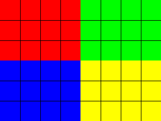

# Visual check: extra image formats

A document for checking by eye, in a real kitty window, the image formats
that only the full build shows, beside [`visual-check.md`](visual-check.md),
which shows one image of each of the other formats. Each section says what
you should see; anything else is a bug.

The full build is the default:

```sh
cargo run -- examples/visual-check-extra-images.md
cargo run -- --light examples/visual-check-extra-images.md
```

A build without default features shows the alt text of every image here in
brackets instead, and warns on stderr about each of them, naming its
format:

```sh
cargo run --no-default-features -- examples/visual-check-extra-images.md
```

## Uncompressed and simple formats

Each of these is the test pattern, red, green, blue and yellow quadrants on
a black grid, about 32 columns wide and 12 rows high, red at the top left.

A BMP:



A PPM, one of the PNM formats:


A run-length encoded TGA, which kiri recognises by its file name:


## Compressed formats

The same test pattern as a TIFF compressed with Deflate, and as a QOI
image:


## Icons

An icon file with transparency: a red disc and a half-transparent blue
square, about 20 columns wide, with the background showing around them and
through the square:


