# Visual check: images

A document for checking kiri's images by eye in a real kitty window, beside
[`visual-check.md`](visual-check.md), which shows one image of each format.
Each section says what you should see; anything else is a bug.

Images show in kitty. Elsewhere, and when an image cannot be loaded, its alt
text appears in brackets. An image is as large next to the text as in a
browser, never enlarged, and never wider than the text. kiri warns on stderr
about the images it cannot load: here the five in the last section.

View it with the default theme, on a document background, and without
colours:

```sh
cargo run -- examples/visual-check-images.md
cargo run -- --theme examples/themes/opaque.toml examples/visual-check-images.md
NO_COLOR=1 cargo run -- examples/visual-check-images.md
```

Try a wide window and a narrow one (about 40 columns), where the wide images
shrink to the narrower text and the small ones keep their size.

## Scaling

Red, green, blue and yellow quadrants on a black grid, about 32 columns
wide and 12 rows high:

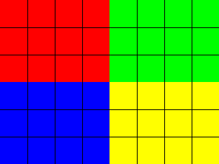

A checkered icon of about two cells, not enlarged:


A gradient from blue to yellow, as wide as the text:


A tall gradient from yellow to blue, about 20 columns wide:


A lake in portrait format, and a large photo of a fern, 4845 pixels wide,
both shrunk to the text width:

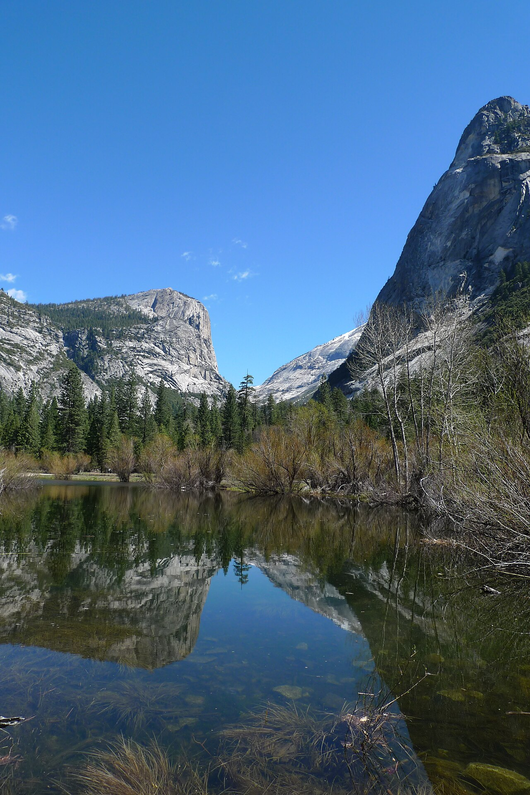

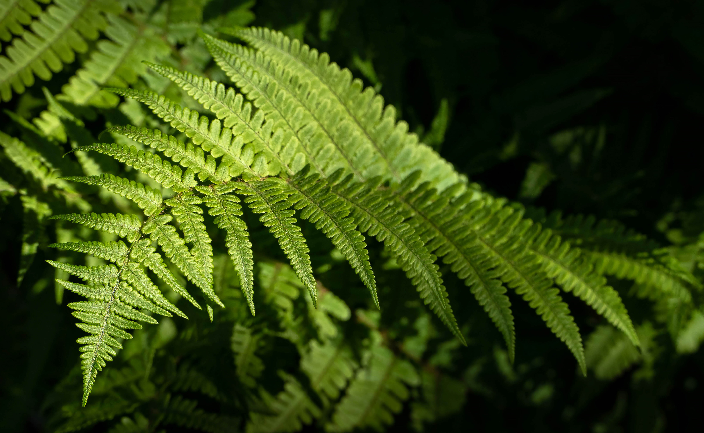

## EXIF orientation

The same photo of a lake under clouds eight times, about 60 columns wide,
each upright although the files store it turned and mirrored in every way
EXIF allows:


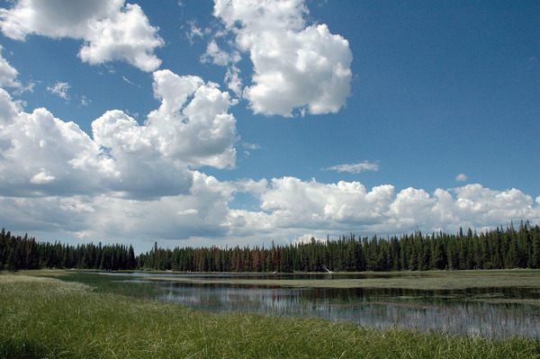

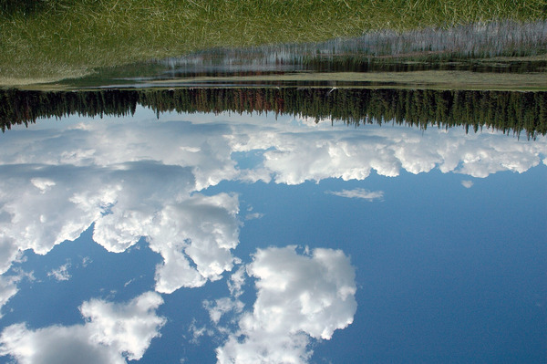

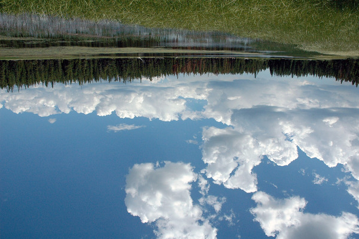

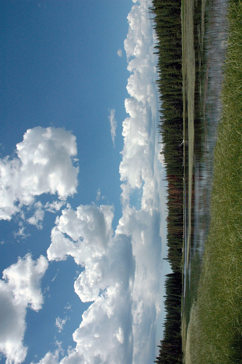

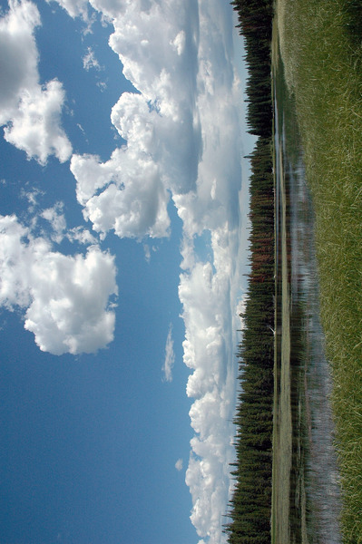

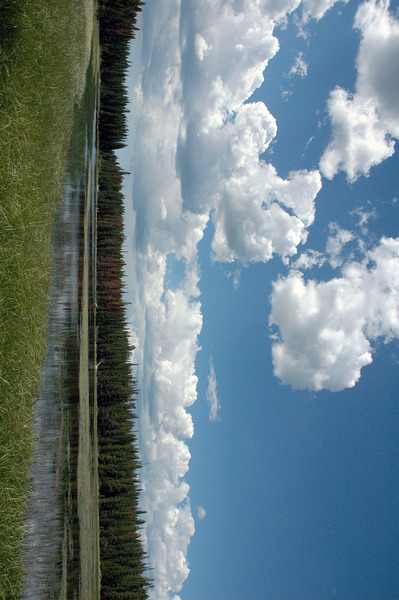

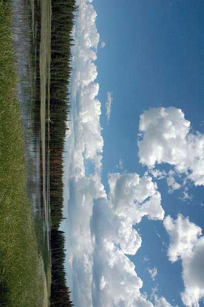

The test pattern stored on its side in a PNG and in a WebP, upright like
the first one on this page, red at the top left:

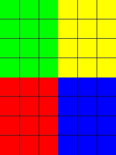


## JPEG variants

The lake as a baseline JPEG, a progressive one and a CMYK one, all as wide
as the text and with the same colours, then a file cut off halfway, whose
lower part is grey or smeared:


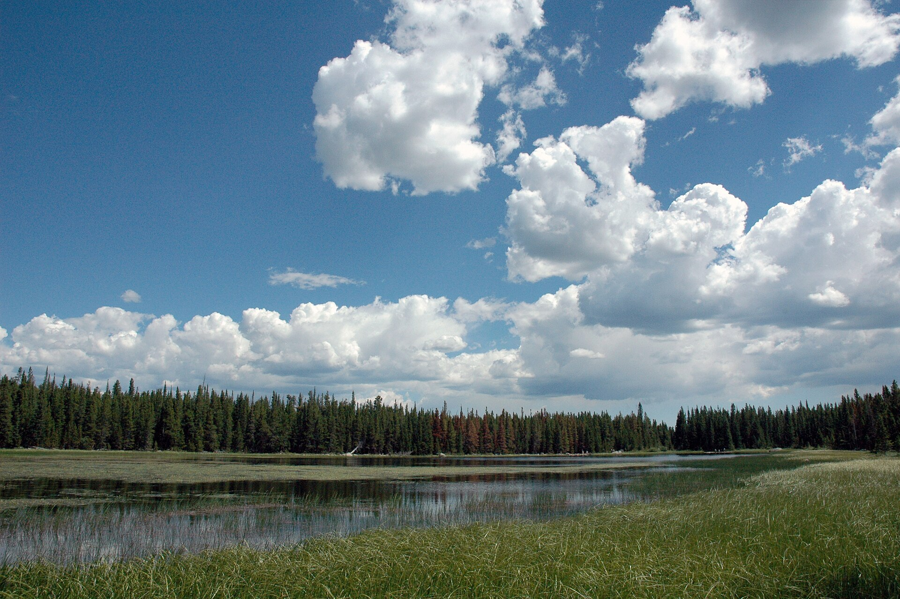


## PNG variants

Five small PngSuite images of about three cells each: 16-bit grey, an
8-bit palette, 16-bit colour with alpha, interlaced grey, and a palette
with a transparent background:


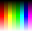

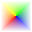

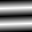


A lossless WebP of a grey noise pattern:

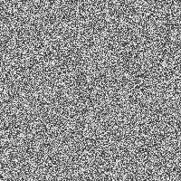

## Transparency

A red disc and a half-transparent blue square, with the background showing
around them and through the square:

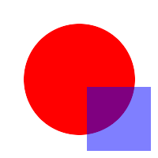

A compass rose without a background of its own, shrunk to the text width.
Its thin lines and points have clean edges, with no light or dark halo
around them on any background:

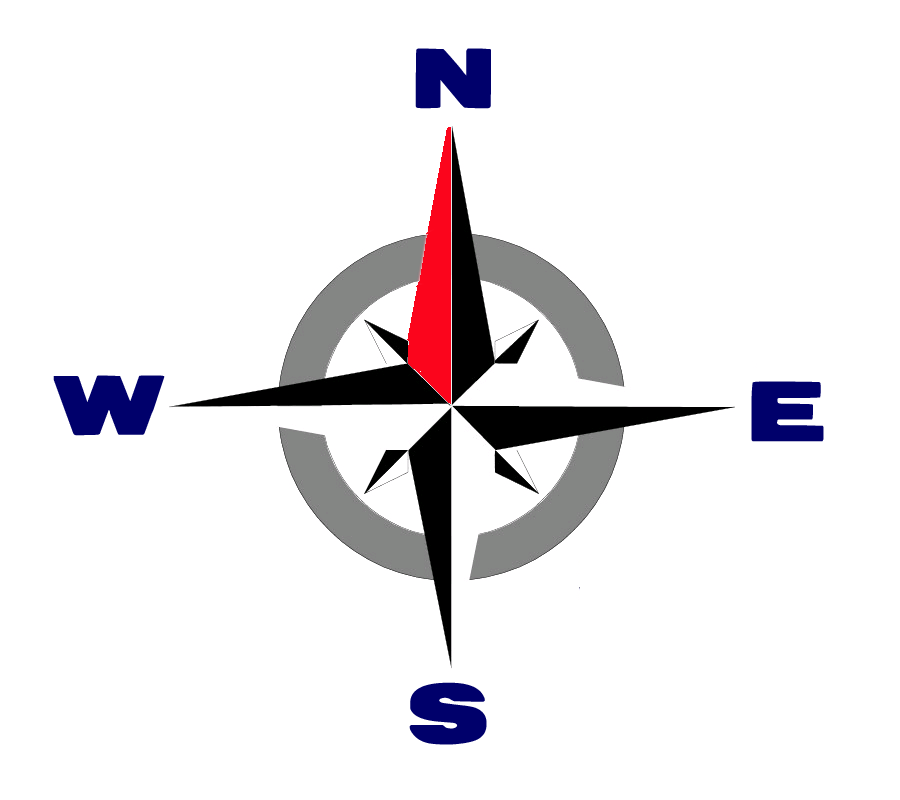

## Animations

Animations stand still on their first frame: a red square from a GIF and
from a WebP of red, green and blue frames, a green puzzle piece with eyes
from an animated GIF, and a beach ball from an animated PNG:

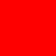


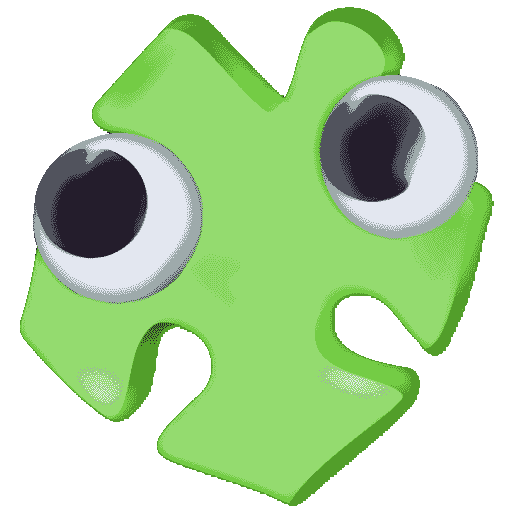

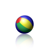

## SVG

SVG images are drawn at the size they are shown, with sharp edges: the test
pattern without its grid, a sunset in gradients about 36 columns wide, and
a small soccer ball:

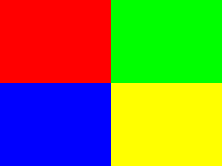

The same pattern again, from a file compressed with gzip:


Their text is set in the system's fonts: the forces on an airfoil, labelled
in Greek in a sans-serif font, and a gearset diagram with English labels in
the default serif font. The labels and arrows are black on a transparent
background, as in a browser, so they show only on a light background: a
light terminal, or a theme with a light `background`.

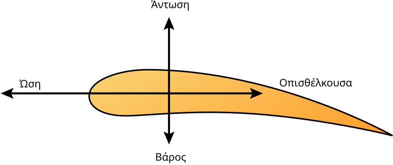

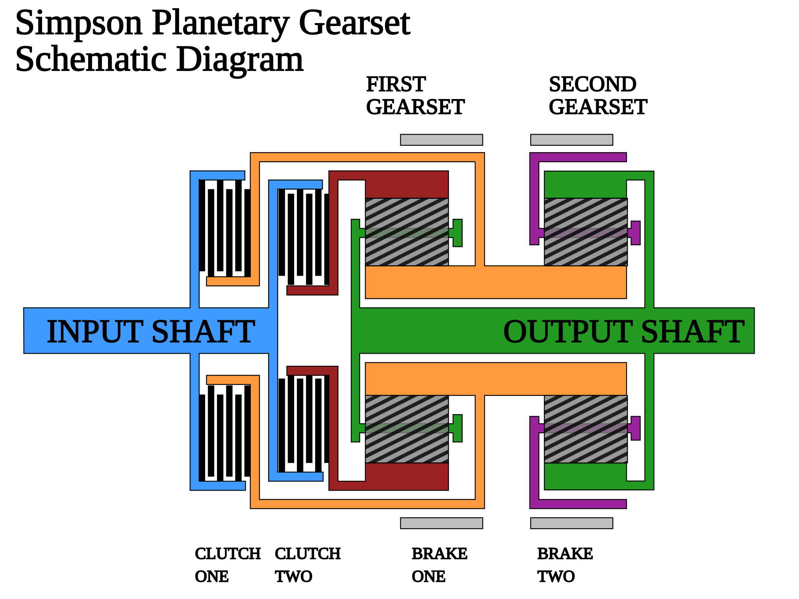

A racetrack in black lines with numbered corners, which also needs a light
background, and a silhouette with softly blurred edges, both as wide as the
text:

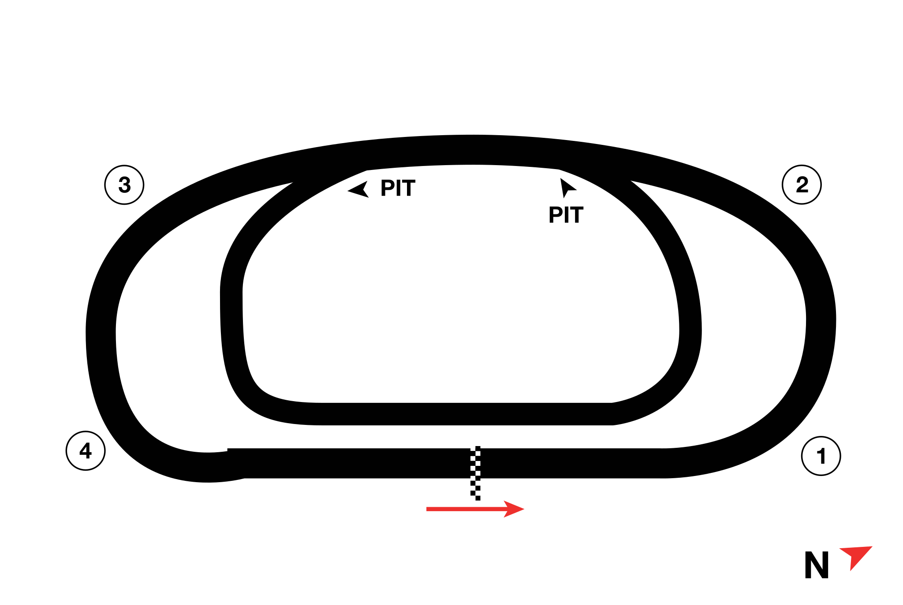


## Lists, quotes and links

Images in a list and a quote start after the bullet and the bar, and the
bar runs beside every row of the image:

- 

- An item with text, then an image lined up with the text:

  

> 

> > 

A linked image shows, but clicking it does nothing yet:

[](https://example.com)

## Alt text

These show their alt text in brackets instead of an image. In running text,
 stays alt text, and so does
[ with words](https://example.com)
in a link. So do two images in one paragraph:

 

### A heading with 

| Image | Note |
|---|---|
|  | Alt text in a table |

A missing file, a file that is no image, a broken SVG, an image with too
many pixels and a remote image show their alt text, and kiri warns about
each of them on stderr:


