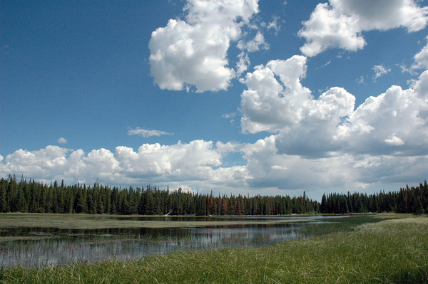
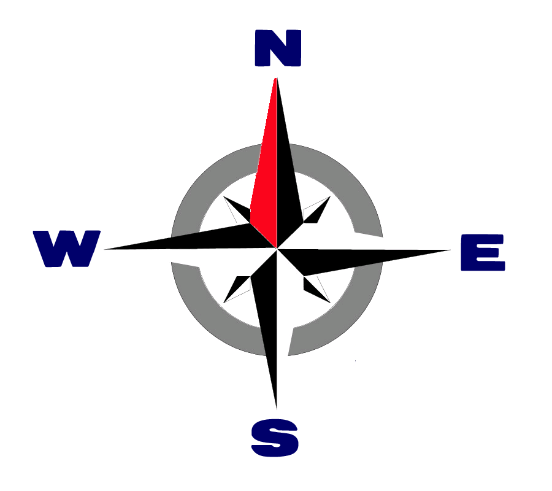

# Visual check

A document for checking kiri's output by eye in a real kitty window. Each
section says what you should see there with the default theme; anything
else is a bug. A theme of your own, from `~/.config/kiri/theme.toml`,
`KIRI_THEME` or the [configuration file](../docs/config.md), changes what
you see. Other terminals show less, and without colours (`NO_COLOR` or
plain text) inline code is shown in backticks.

View it with the default theme, then with the example themes that draw
heading bands and rules, on the light and dark paper themes, and without
colours:

```sh
cargo run -- examples/visual-check.md
cargo run -- --theme examples/themes/background.toml examples/visual-check.md
cargo run -- --theme examples/themes/rules.toml examples/visual-check.md
cargo run -- --light examples/visual-check.md
cargo run -- --dark examples/visual-check.md
NO_COLOR=1 cargo run -- examples/visual-check.md
```

On paper, the document lies on a white or dark grey page as wide as the
window, and everything but the code blocks and the images is in greys: no
blue headings or links, no magenta inline code.

Try a wide window and a narrow one (about 40 columns), where the commands
above wrap like any long code line. No line reaches past the right edge of
the window.

## Heading levels

Level one is three times the normal size, levels two and three twice,
and levels four to six normal size. Underlines, weight, colour and italic
tell the levels of the same size apart.

# Level one

## Level two

### Level three

#### Level four

##### Level five

###### Level six

## Empty blocks

Between this sentence and the next there is an empty heading. It should be
invisible: no line, and no extra blank line.

#

After the empty heading. Next comes an empty code block, which is invisible
in the same way.

```
```

After the empty code block. In the list below, the second item is empty:
its line shows the bullet and nothing after it.

- First item
-
- Third item

## Code blocks

A line too long for the window wraps inside the block. The continuation
starts at the same left edge as the code, and the block's background ends
at the same right edge on every line.

```rust
let line = "long enough to wrap in most windows, with its spaces kept as written and nothing lost at the break";
```

Inline code keeps its runs of spaces: `git  commit   -m` has two spaces
after `git` and three after `commit`.

## Block quotes

> ### A heading in a quote
>
> The heading above is normal size, starts right after the bar, and the
> bar runs beside it.
>
> ```rust
> let quoted = true;
> ```
>
> The bar continues beside the code block, and blank lines inside the
> quote end at the bar.
>
> | Key | Value |
> |-----|------:|
> | a   | 1     |
> | bb  | 22    |
>
> The table sits after the bar, with its values aligned right.
>
> - A list in a quote
>   - A deeper item

> An outer quote.
>
> > A nested quote: two bars, side by side.
> >
> > Its blank line ends at the second bar.
>
> Back in the outer quote, with one bar.

## Lists

- ### A heading in a list item

  The heading starts right after the bullet, at normal size.

  ```
  code in an item
  ```

  The code block above lines up with the item's text.

  | Key | Value |
  |-----|-------|
  | b   | 2     |

  > A quote in an item; its bar lines up with the item's text.

1. The first paragraph of a loose item.

   A second paragraph of the same item, after a blank line and lined up
   with the first.

2. The second item, separated from the first by a blank line.

   - A list nested in a loose item.

## Wide characters

CJK, emoji, flags and joined emoji each take two cells and never split:
日本語のテキストと漢字, 🦀, 🇫🇮 🇯🇵, 👨‍👩‍👧 and ❤️. Lines with them still end
inside the window.

### 日本語の見出し 🦀 🇫🇮

The heading above holds wide characters and is drawn as large as the other
level-three headings.

| 名前 | Emoji | Flag |
|------|-------|------|
| 東京 | 🦀    | 🇯🇵   |
| Oslo | 🌲🌲  | 🇳🇴   |
| Koti | 👨‍👩‍👧    | 🇫🇮   |

Every row of the table above has its borders in line.

```
let 名前 = "東京"; // 🦀 🇫🇮 👨‍👩‍👧
```

## Narrow tables

This table is wider than the default text width of 100 cells, so the text
of its cells wraps inside the columns, the right-aligned notes included.
The borders stay in line, `new` is inline code, and the link is a link.
No word of ten cells or fewer is split while another column can give up
room.

| Element | Status | Notes |
|:--------|:------:|------:|
| Headings | done | Scaled with OSC 66 in kitty, bold and coloured elsewhere, with a rule or a band from the theme |
| Tables | `new` | Wrapped inside their columns when the window is narrow, keeping *inline* styles and [links](https://example.com) |

## Inline code in tables

The commands in this table wrap at their spaces like the text beside
them, and the table stays a box down to about 35 columns. With
`inline_code_wrap = false` in your theme, each command stays on one line
while the last column keeps room for its text, at about 70 columns and
wider; in a narrower window the table looks the same as by default.

| Step | Command | What it does |
|------|---------|--------------|
| Stage | `git add -p` | Picks the changes to commit, hunk by hunk |
| Commit | `git commit -m "Fix the parser"` | Records them with a message |

## Stacked tables

This table cannot fit without splitting short words, so each row becomes
its own block: one line per cell, the header in bold, a colon and the
value. A value that wraps continues at the left edge. Thin rules in the
table border colour separate the rows, with none above the first or below
the last. Empty cells show their header alone, and the styles inside
cells still show. In a window narrower than about 27 columns, each value
goes on the lines under its header instead.

| Language | Paradigm | Typing | Memory | Concurrency | Released | Toolchain | License | Notes |
|----------|----------|--------|--------|-------------|---------:|-----------|---------|-------|
| Rust | multi-paradigm | statically | ownership | async/await, threads | 2015 | cargo/rustup | MIT/Apache-2.0 | A crab 🦀, `cargo build`, and [the book](https://doc.rust-lang.org/book/) |
| Python | multi-paradigm | dynamically | garbage-collected | asyncio, threads | 1991 | pip/uv | PSF-2.0 | *Batteries included*: a large standard library, an interactive shell, and a package index with hundreds of thousands of projects to install |
| Lisp | functional | dynamically | garbage-collected | | 1958 | | | |

> The same table in a quote, stacked inside the bar:
>
> | Language | Paradigm | Typing | Memory | Concurrency | Released | Toolchain | License | Notes |
> |----------|----------|--------|--------|-------------|---------:|-----------|---------|-------|
> | Rust | multi-paradigm | statically | ownership | async/await, threads | 2015 | cargo/rustup | MIT/Apache-2.0 | A crab 🦀 |
> | Lisp | functional | dynamically | garbage-collected | | 1958 | | | |

## Links

The link at the end of this sentence is long enough to wrap onto the next
line: [a link whose text goes on long enough to span two lines in most windows](https://example.com/visual-check).
Every line of it is underlined and opens the same page.

## Images

One image of each format, and a few special cases;
[`visual-check-images.md`](visual-check-images.md) has the rest. Images
show in kitty; elsewhere, and when an image cannot be loaded, its alt text
appears in brackets. An image is as large next to the text as in a
browser, never enlarged, and never wider than the text. kiri warns on
stderr about the images it cannot load: here only the missing file at the
end.

A PNG: red, green, blue and yellow quadrants on a black grid, about 32
columns wide and 12 rows high:


A JPEG: a lake under clouds, about 60 columns wide:



A GIF, its first frame standing still: a green puzzle piece with eyes,
about 51 columns wide:


A lossy WebP, about 30 columns wide:


An SVG, drawn at the size it is shown with sharp edges: a sunset in
gradients, about 36 columns wide:


A compass rose without a background of its own, as wide as the text, with
no light or dark halo around its thin lines:



An image in a quote starts after the bar, which runs beside every row:

> 

In running text,  stays alt
text, as does a missing file:


