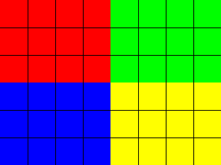

# Image formats

The full build shows images in these formats as well; a minimal build shows
their alt text.

A BMP:

A TIFF:

A QOI image:

A PPM, one of the PNM formats:

A TGA, recognised by its file name:

An icon with transparency:

