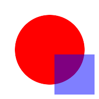

# HTML images

An `` tag on a line of its own is shown like a Markdown image:

So is an image wrapped the way READMEs centre a logo; kiri does not centre
it:

  

A `<picture>` shows its ``, whatever its sources say:

<picture>
  <source media="(prefers-color-scheme: dark)" srcset="images/portrait.png">
  
</picture>

In running text,  stays alt
text, as Markdown images do.

A missing file shows its alt text:

These stay HTML source: a block with text, a block with two images and an
`` without a `src`.

Text and 

