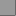
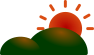
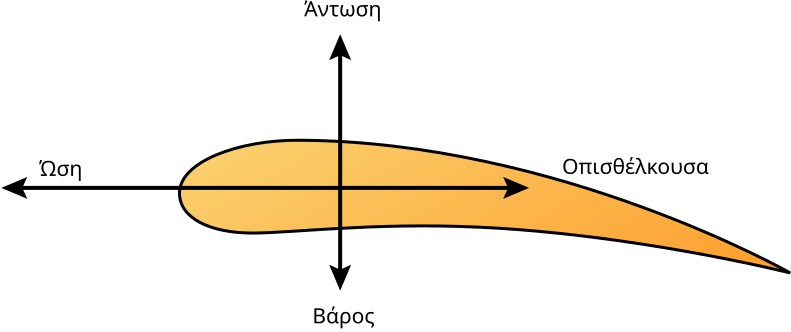
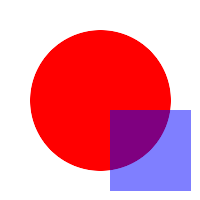

# Images

An image alone in a paragraph is shown at its natural size:

A small image is not enlarged:

A wide image shrinks to the text width:

An SVG is drawn at its natural size, here given in millimetres:

Text in an SVG is drawn with the system's fonts:

A linked image is shown, but cannot be clicked yet:

- An image in a list:

  

- 

> An image in a quote:
>
> 

In running text,  is an image in the line,
and so is [ with words](https://example.com) in a
link.

| Image | Note |
|---|---|
|  | Alt text in a table |

A missing file, a file that is no image, a broken SVG and a remote image
show their alt text:

