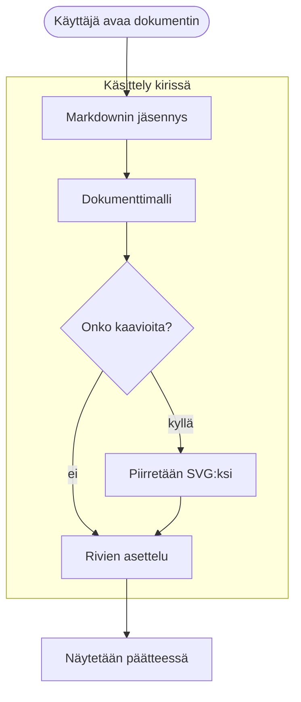
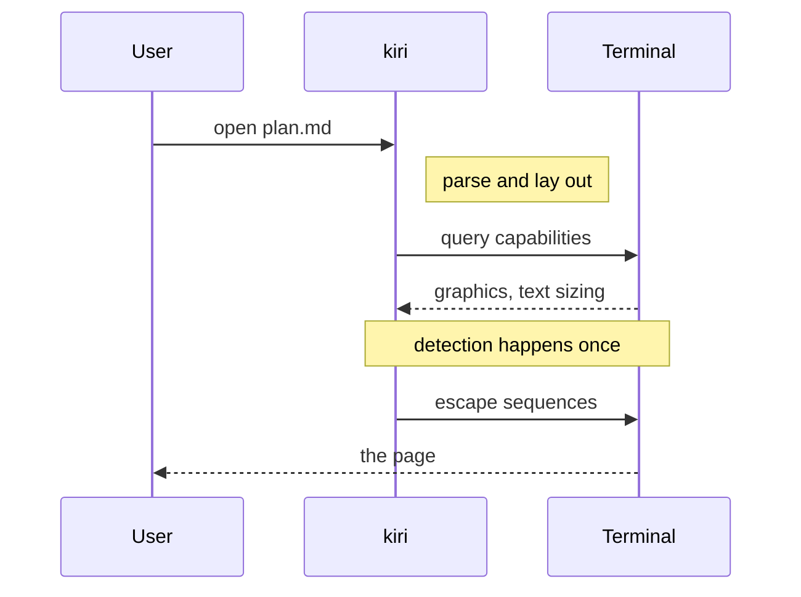
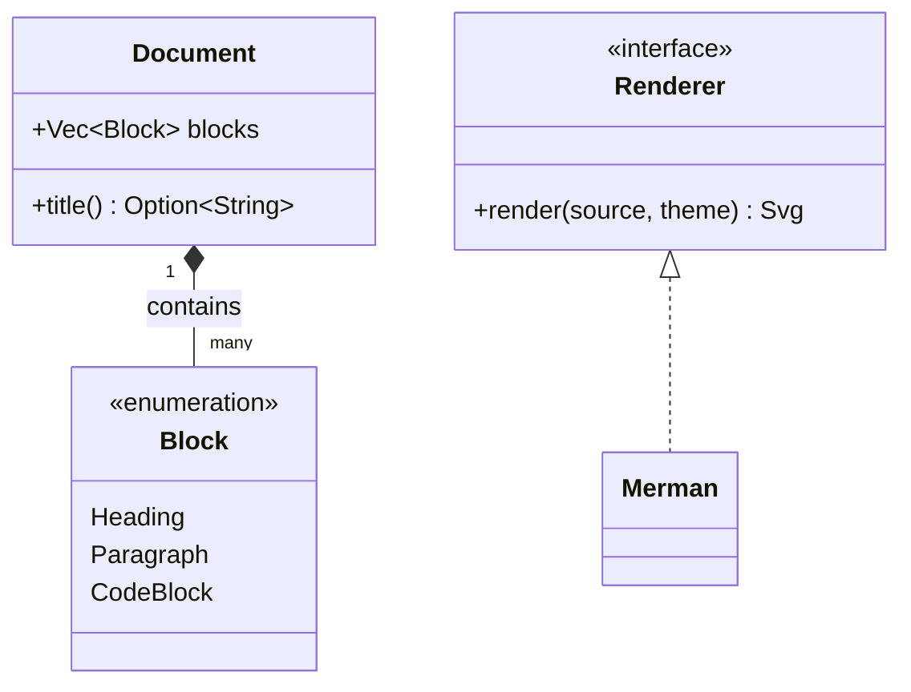
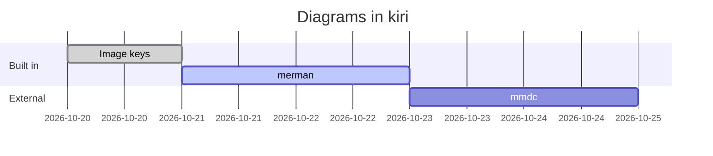
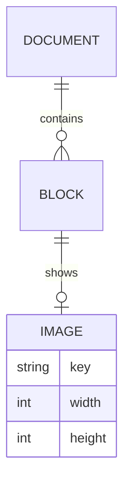
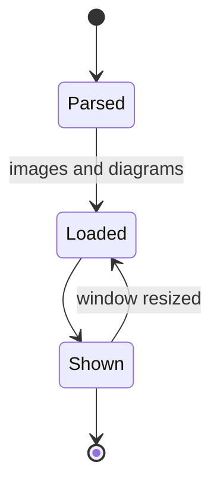
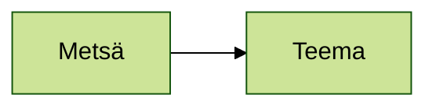

# Mermaid diagrams

A flowchart with a subgraph and Finnish text:



A sequence diagram with notes:



A class diagram:



A Gantt chart:



An entity relationship diagram:



A state diagram:



A diagram with a syntax error stays code and says why:

```mermaid
flowchart LR
    A[Unclosed label --> B
```

- A diagram in a list:

  ```mermaid
  flowchart LR
      Lista --> Kohta
  ```

> A diagram in a quote:
>
> ```mermaid
> flowchart LR
>     Lainaus --> Kaavio
> ```

A diagram that sets its own theme keeps it on any page:


